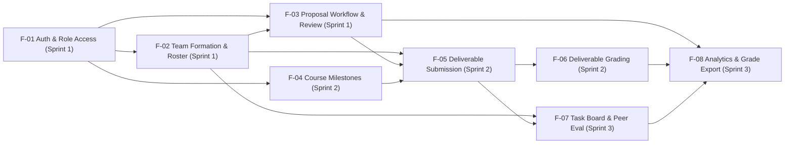

# Part B: Feature Inventory

This document defines the complete feature inventory (`F-01` through `F-08`) across Sprints 1, 2, and 3 for **CoursePMS (Course Project Management System)**, including linked requirements (`FR`, `BR`, `NFR`), dependencies, and planned sprint allocation.

**22 November 2026 status:** F-01–03 have the accepted Sprint 1/Lab 6
implementation. F-04–08 now have concrete proposed contracts/AC/STS below;
they are not implemented or verified complete by writing the contracts.
Independent review is pending. Required Sprint 2 allocation is unchanged.

---

## 1. Feature Inventory Table

| Feature ID | Feature Name | Short Description | Linked Requirements | Dependencies | Planned Sprint |
| :--- | :--- | :--- | :--- | :--- | :---: |
| **F-01** | Authentication, Session & Role Access Control | Real email/password login, backend token/session verification, current-user retrieval (`/api/auth/me`), server-enforced logout revocation, and `STUDENT` / `INSTRUCTOR` role guards. | `FR-01`, `BR-06`, `NFR-01`, `NFR-02`, `NFR-03`, `NFR-05` | None (Foundation) | **Sprint 1** |
| **F-02** | Course Project Team Formation & Roster Management | Create a project team in a course, join/add student members, view team roster, and enforce single-team-per-course and maximum team capacity rules. | `FR-02`, `FR-03`, `BR-01`, `BR-02`, `BR-06`, `NFR-01`, `NFR-02`, `NFR-04` | `F-01` | **Sprint 1** |
| **F-03** | Project Proposal Drafting, Submission & Instructor Review | Draft and submit team project proposals (`DRAFT` → `SUBMITTED`), enforce completeness and team-ownership privacy, and allow Instructors to review (`APPROVED` / `REVISION_REQUESTED`) with mandatory feedback. | `FR-03`, `FR-04`, `FR-05`, `BR-03`, `BR-04`, `BR-05`, `BR-06`, `NFR-01`, `NFR-02`, `NFR-04` | `F-01`, `F-02` | **Sprint 1** |
| **F-04** | Course Milestone Definition & Schedule Management | Allow Instructors to create, edit, and publish course milestones with descriptions, grading weights, and submission deadlines. | `FR-06`, `NFR-01`, `NFR-02`, `NFR-04` | `F-01` | **Sprint 2** |
| **F-05** | Team Milestone Deliverable Submission | Allow teams with an `APPROVED` proposal to submit milestone deliverables (repo tag, report URL, release notes) and track submission timestamps against deadlines. | `FR-07`, `BR-06`, `BR-07`, `NFR-01`, `NFR-02`, `NFR-04` | `F-02`, `F-03`, `F-04` | **Sprint 2** |
| **F-06** | Instructor Deliverable Grading & Rubric Feedback | Enable Instructors to evaluate submitted team deliverables with bounded numerical scores (`0–100`) and written feedback visible only to the owning team and instructors. | `FR-08`, `BR-06`, `BR-08`, `NFR-01`, `NFR-02` | `F-05` | **Sprint 2** |
| **F-07** | Intra-Team Sprint Task Board & Peer Evaluation | Provide a team-scoped task board (`TODO`, `IN_PROGRESS`, `DONE`) and confidential peer contribution evaluation form per milestone (preventing self-ratings). | `FR-09`, `FR-10`, `BR-06`, `BR-08`, `NFR-01`, `NFR-02` | `F-02`, `F-05` | **Sprint 3** |
| **F-08** | Instructor Course Analytics Dashboard & Grade Export | Aggregate course-wide team proposal states, milestone completion rates, and ungraded queues, and provide one-click CSV gradebook export. | `FR-11`, `FR-12`, `NFR-01`, `NFR-02`, `NFR-04` | `F-03`, `F-06`, `F-07` | **Sprint 3** |

---

## 2. Feature Dependency Graph

## 3. Current contract and implementation status

| Feature | Owner | Versioned planned contract | Implementation / new verification |
| --- | --- | --- | --- |
| F-01–03 | Existing confirmed Sprint 1 allocation | Existing Sprint 1 contracts; [continuity record](sprints/deliverable-2/continuity-and-status.md) | Implemented historically; new D2 candidate checks pending |
| F-04 | martinvadre | [S2-F04 v1.0](sprints/sprint-2/f04-milestones.md) | Not implemented / NOT RUN |
| F-05 | Magiciancat9 | [S2-F05 v1.0 + execution addendum](sprints/sprint-2/f05-submissions.md) | Implemented feature-branch candidate; [real tests and explicit F-06/release gates](sprints/sprint-2/f05-execution-evidence.md); independent review pending |
| F-06 | martinvadre | [S2-F06 v1.0](sprints/sprint-2/f06-grading.md) | Not implemented / NOT RUN |
| F-07 | Magiciancat9 | [S3-F07 v1.0](sprints/sprint-3/f07-collaboration.md) | Task checkpoint and remaining peer work both unimplemented / NOT RUN |
| F-08 | martinvadre | [S3-F08 v1.0](sprints/sprint-3/f08-analytics-export.md) | Not implemented / NOT RUN |

All v1.0 contracts are drafted by Magiciancat9 for teammate review, including
teammate-owned feature contracts; no authorship/approval is attributed to
martinvadre. The [UI refresh](ui-refresh-spec.md) is a cross-cutting planned
presentation change, not an extra completed domain feature. The [verification
register](sprints/deliverable-2/verification-register.md) distinguishes planned
test IDs/locations from actual execution and accepted releases.
