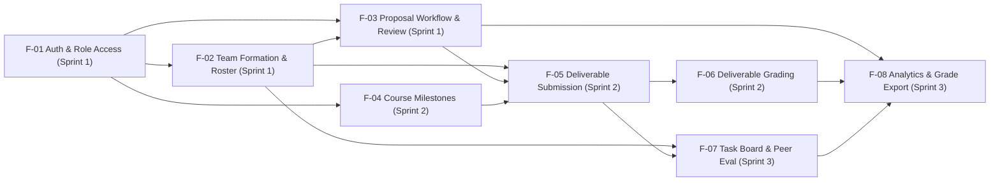

# Feature Inventory

This document defines the complete feature inventory (`F-01` through `F-08`) across Sprints 1, 2, and 3 for **CoursePMS (Course Project Management System)**, including linked requirements (`FR`, `BR`, `NFR`), dependencies, and planned sprint allocation.

**25 November 2026 status:** maintained Sprint 1 includes approved Lab 7.
F-04/F-05/F-06 are implemented, independently reviewed and integrated in the
[Sprint 2 release candidate](sprints/sprint-2/accepted-release.md). Main
deployment is recorded; authenticated release acceptance and immutable tag
remain explicit gates. F-07/F-08
contracts were reviewed; F-07 task checkpoint is implemented separately under
#98. Peer AC07-12 are implemented/tested on #101's feature branch, pending
independent code review/integration; F-08 implementation remains planned.

---

## 1. Feature Inventory Table

| Feature ID | Feature Name | Short Description | Linked Requirements | Dependencies | Planned Sprint |
| :--- | :--- | :--- | :--- | :--- | :---: |
| **F-01** | Authentication, Session & Role Access Control | Real email/password login, backend token/session verification, current-user retrieval (`/api/auth/me`), server-enforced logout revocation, and `STUDENT` / `INSTRUCTOR` role guards. | `FR-01`, `BR-06`, `NFR-01`, `NFR-02`, `NFR-03`, `NFR-05` | None (Foundation) | **Sprint 1** |
| **F-02** | Course Project Team Formation & Roster Management | Create a project team in a course, join/add student members, view team roster, and enforce single-team-per-course and maximum team capacity rules. | `FR-02`, `FR-03`, `BR-01`, `BR-02`, `BR-06`, `NFR-01`, `NFR-02`, `NFR-04` | `F-01` | **Sprint 1** |
| **F-03** | Project Proposal Drafting, Submission & Instructor Review | Draft and submit team project proposals (`DRAFT` → `SUBMITTED`), enforce completeness and team-ownership privacy, and allow Instructors to review (`APPROVED` / `REVISION_REQUESTED`) with mandatory feedback. | `FR-03`, `FR-04`, `FR-05`, `BR-03`, `BR-04`, `BR-05`, `BR-06`, `NFR-01`, `NFR-02`, `NFR-04` | `F-01`, `F-02` | **Sprint 1** |
| **F-04** | Course Milestone Definition & Schedule Management | Allow Instructors to create, edit, and publish course milestones with descriptions, grading weights, and submission deadlines. | `FR-06`, `NFR-01`, `NFR-02`, `NFR-04` | `F-01` | **Sprint 2** |
| **F-05** | Team Milestone Deliverable Submission | Allow teams with an `APPROVED` proposal to submit milestone deliverables (repo tag, report URL, release notes) and track submission timestamps against deadlines. | `FR-07`, `BR-06`, `BR-07`, `NFR-01`, `NFR-02`, `NFR-04` | `F-02`, `F-03`, `F-04` | **Sprint 2** |
| **F-06** | Instructor Deliverable Grading & Rubric Feedback | Enable Instructors to evaluate submitted team deliverables with bounded numerical scores (`0–100`) and written feedback visible only to the owning team and instructors. | `FR-08`, `BR-06`, `BR-08`, `NFR-01`, `NFR-02` | `F-05` | **Sprint 2** |
| **F-07** | Intra-Team Sprint Task Board & Peer Evaluation | Provide a team-scoped task board (`TODO`, `IN_PROGRESS`, `DONE`) and confidential peer contribution evaluation form per milestone (preventing self-ratings). | `FR-09`, `FR-10`, `BR-06`, `BR-08`, `NFR-01`, `NFR-02` | `F-02`, `F-05` | **Sprint 3** |
| **F-08** | Instructor Course Analytics Dashboard & Grade Export | Aggregate course-wide team proposal states, milestone completion rates, and ungraded queues, and provide one-click CSV gradebook export. | `FR-11`, `FR-12`, `NFR-01`, `NFR-02`, `NFR-04` | `F-03`, `F-06`, `F-07` | **Sprint 3** |

---

## 2. Feature Dependency Graph

## 3. Current contract and implementation status

| Feature | Owner | Versioned planned contract | Implementation / new verification |
| --- | --- | --- | --- |
| F-01–03 | Existing confirmed Sprint 1 allocation | Existing Sprint 1 contracts; [continuity record](sprints/deliverable-2/continuity-and-status.md) | Maintained behavior rerun in S2-CI/S3-CI; final combined RC checks remain #93 |
| F-04 | martinvadre | [S2-F04 v1.0](sprints/sprint-2/f04-milestones.md) | Implemented/reviewed; combined release results and gates in [S2 ledger](sprints/sprint-2/accepted-release.md) |
| F-05 | Magiciancat9 | [S2-F05 v1.0 + execution addendum](sprints/sprint-2/f05-submissions.md) | Implemented/reviewed via PR #117; [S2 release ledger](sprints/sprint-2/accepted-release.md) |
| F-06 | martinvadre | [S2-F06 v1.0](sprints/sprint-2/f06-grading.md) | Implemented/reviewed via PR #118; [S2 release ledger](sprints/sprint-2/accepted-release.md) |
| F-07 | Magiciancat9 | [S3-F07 v1.0](sprints/sprint-3/f07-collaboration.md) | Task checkpoint AC01-06 implemented/tested/reviewed and merged #120 to S3 staging; [actual results/review gates](sprints/sprint-3/f07-execution-evidence.md). Peer AC07-12 implemented/tested on #101 feature branch; [peer evidence](sprints/sprint-3/f07-peer-execution-evidence.md); independent review/integration and accepted release pending |
| F-08 | martinvadre | [S3-F08 v1.0](sprints/sprint-3/f08-analytics-export.md) | Contract reviewed #107; #99 contract checkpoint closed. Operational implementation NOT IMPLEMENTED / NOT RUN |

Original v1.0 drafts were authored by Magiciancat9; martinvadre independently
reviewed the contract package in PR #107 before implementation. Code PRs
retain their respective authors and opposite-member reviews. The refreshed
UI is implemented via PR #110. [Verification register](sprints/deliverable-2/verification-register.md)
separates executable Sprint 2 results from planned Sprint 3 work and full
visual acceptance checks.

## 4. Responsibility and achieved versus remaining scope

Sprint 2 requires all 27 F-04/F-05/F-06 AC, not a subset moved to Sprint 3.
All 27 have actual tests/reviews; #97 still preserves the accepted main/tag
and authenticated release evidence. F-07 is deliberately split: six task AC
achieved on reviewed staging, six peer AC remain #101. All ten F-08 AC remain
#102 even though contract checkpoint #99 is closed. Existing proposal-status
cards do not count as the unimplemented aggregate/CSV feature.

The [finish plan](sprints/deliverable-2/continuity-and-status.md#5-exact-remaining-work-risk-and-completion-plan)
assigns every remaining scope and verification gap to an owner/dependency,
concrete next action and target. #100 does not approve a scope reduction.
