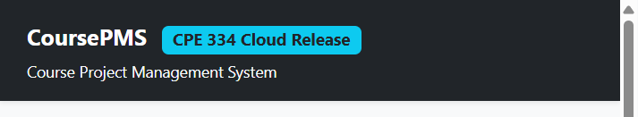

# CoursePMS: partner UAT handoff

**Status: preparation; independent UAT and acceptance not yet recorded.**
Product Team: EN-022_P6, Tatchakorn Thamnimitr (`Magiciancat9`) and Pawarit
Wongdaeng (`martinvadre`). Independent UAT Team: EN-028 InfaCompany, Supapanya
Yathip (`zerotwobook`) and Atip Infa-udom (`Atip-Infa`). Both partner members
should participate and record what they actually test.

## Product and baseline

| Item | Information |
|---|---|
| Product | CoursePMS, Course Project Management System |
| Repository | <https://github.com/Magiciancat9/Course_management> |
| Application | <https://course-pms-859617270560.asia-southeast1.run.app> |
| Course | CPE334, Semester 1/2026; verify the active course and its actual ID |
| Sprint 1 tag | `v1.0.0-sprint1` at `5979f5870e8e28277996dc3045cbf4be5f7236ad` |
| Selected deployed source | `150dc5db3de5c829a7d9ef1adb545191cc37542d` |
| Historical deployment | Run `43368602701` reported revision `course-pms-00006-sbx` with 100% traffic at deployment; current traffic needs owner confirmation |

On 13 November 2026 at approximately 19:09 Asia/Bangkok, the public health
endpoint returned HTTP 200 and the selected source commit; readiness returned
HTTP 200 and database `connected`. These are preparation checks, not a UAT
result. Health identifies source, not the serving Cloud Run revision. Verify
both source and revision at the start of the actual session.

*Preparation image: cropped public page opened at the application URL above.
It does not prove a business flow, release revision or independent UAT.*

## Scope and rules

- F-01: Student/Instructor sign-in, identity, authorization and logout.
- F-02: create a team and add eligible members; BR-01 one team per course and
  BR-02 maximum size.
- F-03: save, submit and review proposals; BR-03 status locks, BR-04
  completeness, BR-05 review feedback and BR-06 role/ownership isolation.
- [The eight cases](uat-cases.md) map to AC-01--AC-10 and include saved-state
  readback, but do not cover every contract subcheck. Later-sprint
  milestones, grading and analytics are outside scope.

The Product Team reported that test accounts were checked and credentials
sent privately. This is not a recorded independent per-account smoke test.
Confirm access and the following current states privately before testing:

| Alias | Required role and starting state |
|---|---|
| I | Instructor |
| S1 | Eligible student, unassigned in CPE334; creates the UAT team |
| S2, S3, S4 | Eligible students, each initially unassigned in CPE334 |
| F | Student already in a different CPE334 team |

The original seed only describes three initially unassigned students; it does
not prove current account states or a usable fourth candidate. The owner must
confirm S4 or agree a safe equivalent fixture; otherwise the capacity
subcheck is BLOCKED. Confirm actual `maxTeamSize` is 3 for the expected 3/3
case. Use isolated browser profiles and do not publish account mappings,
passwords, tokens or authorization headers.

## Synthetic inputs and sequence

| Input | Value |
|---|---|
| Run ID / new team | `CPMS-L6-20261113-R1` / `CPMS-L6-20261113-R1-Team`; agree a unique suffix for each run |
| Incomplete title / problem / stack | `Test` / `Too short` / `TS` |
| Complete title | `CoursePMS Independent UAT Proposal` |
| Problem statement | `Student teams need a clear and private project proposal review workflow.` |
| Tech stack | `React, Express, PostgreSQL` |
| Repository URL | `https://example.com/coursepms-uat` |
| Revised title | `CoursePMS Independent UAT Proposal Revised` |
| Revision feedback | `Please clarify the implementation and acceptance evidence.` |
| Approval feedback | `The revised proposal scope is clear and suitable for the course.` |

Execute CPMS-UAT-01 through CPMS-UAT-08 in order. The current UI selects the
first course automatically; it does **not** offer a course picker. Verify the
displayed course and pause if it is not CPE334. This corrects the instruction
in the already-shared ZIP; send the correction to the partner and confirm
receipt rather than assuming their copy changed.

Record actual course, team and proposal IDs through authorized reads as needed.
Some IDs and timestamps are not displayed in the UI. A disabled control does
not prove a backend response: use a private authorized API session for the
specified checks, or mark that subcheck BLOCKED. Save sanitized evidence,
including the observed status/code and before/after state for denied writes.

## Handoff and safety

Confirm packet receipt, session and retest times, private alias mapping,
fixture state, actual deployed revision and evidence location with the
partner. Coordinate and report findings through **private chat**; record
sanitized reports and acknowledgement in
[findings and retest](findings-and-retest.md).

Retain synthetic records and IDs for retest and grading. The UI provides no
general team-removal or proposal-reset workflow; a new name alone does not
free members for a fresh run. Agree a fresh eligible fixture before reruns.
Do not reset, seed, delete or otherwise alter the shared database as cleanup.
The detailed handoff remains in
[PR #61](https://github.com/Magiciancat9/Course_management/pull/61) pending
review and merge.
