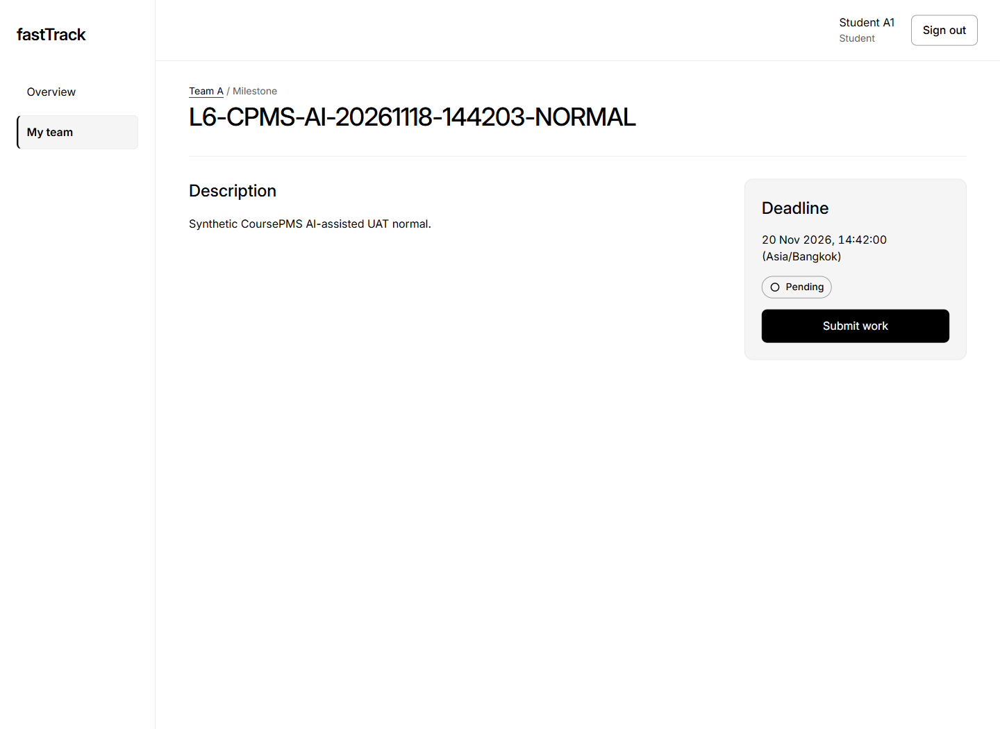
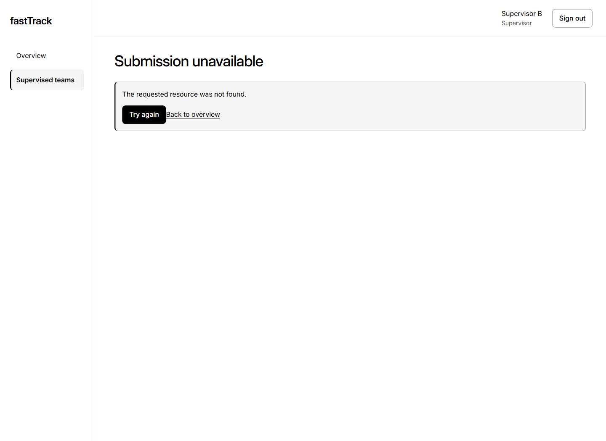

# CPE334 Lab 6 — Independent UAT Report

## PDF source: front matter, Part A, and Part B

**Assembly status:** Markdown source for the final single PDF. The PDF itself
is intentionally not committed. Page ranges below are the planned layout and
must be reconciled once Parts C and D are assembled in the final renderer.

## Front matter

| Field | Record |
|---|---|
| Course / lab | CPE334 Software Engineering — Lab 6: Independent UAT and Defect Management |
| Product Team / product | EN-022_P6 — CoursePMS, Course Project Management System |
| Students | Tatchakorn Thamnimitr (67070503415, `Magiciancat9`); Pawarit Wongdaeng (67070503466, `martinvadre`) |
| Repository | <https://github.com/Magiciancat9/Course_management> |
| CoursePMS Sprint 1 scope | F-01 authentication and roles; F-02 team management; F-03 proposal and instructor review; AC-01–AC-10 |
| Sprint 1 baseline | `v1.0.0-sprint1` / `5979f5870e8e28277996dc3045cbf4be5f7236ad` |
| Corrected CoursePMS release | main `aeb804ea5bc667399b00cf54df10046a6ded46e0`; Cloud Run `course-pms-00009-mk2` (dated 100% traffic evidence) |
| CoursePMS URL / independent decision | <https://course-pms-859617270560.asia-southeast1.run.app/> — **Accepted** by fastTrack's recorded joint decision on 17 November 2026, 22:30:56 Asia/Bangkok |
| Partner product / UAT Team | fastTrack (EN-028 InfaCompany) — CoursePMS independently tested fastTrack Sprint 1 |
| fastTrack source / decision | `8e637e537cd037d630a5fffc1b5672d1b44371a8` — **Accepted** in the user-reported joint CoursePMS decision on 19 November 2026 |

### Evidence and attribution notice

This report separates product-team evidence from independent-UAT evidence.
The 18 November fastTrack technical execution was operated by Codex AI; its
screenshots and timestamps are not relabelled as personal student actions. A
later user-reported joint human review/testing declaration is recorded with its
own limitations: no individual case times, fixture IDs, Network captures, or
separate human-session screenshots were retained. Credentials, tokens,
cookies, authorization headers, and private student identities are excluded.

## Planned contents and evidence map

| Planned PDF pages | Section | Evidence IDs / contents |
|---:|---|---|
| 1–2 | Front matter and contents | Release identities, decision boundaries, attribution notice |
| 3–7 | Part A — CoursePMS packet and UAT cases | CPMS-UAT-01–08; safe labels I/S1–S4/F; sanitized setup/cleanup |
| 8–11 | Part B — CoursePMS testing fastTrack | FT-B-01 normal journey; FT-B-05/06 negative-access; UAT-01–08 case ledger |
| 12–14 | Parts C–D (assembled separately) | Finding triage, correction, release, independent retest, final decisions |
| 15 | Evidence index and limitations | Evidence paths, source/revision and record limitations |

---

# Part A — CoursePMS product handoff and executable UAT cases

## A.1 Responsibility and scope

CoursePMS is the Product Team for this section. fastTrack (EN-028) is the
independent UAT Team that evaluates CoursePMS. These cases are the executable
Sprint 1 packet; they are not evidence that the Product Team performed the
partner's independent testing.

The packet covers F-01–F-03 and AC-01–AC-10. Later-sprint milestones,
grading, and analytics are outside scope. Use isolated browser profiles and
record tester, date/time (Asia/Bangkok), source/revision, actual action,
actual result, status, and sanitized evidence ID for every run.

## A.2 Safe setup, release gate, and cleanup

| Item | Required safe handling |
|---|---|
| Accounts | Use private aliases only: `I` (instructor), `S1`–`S4` (eligible students), and `F` (student in another team). Never publish credentials. |
| Starting state | Verify live source/revision, CPE334 course, `maxTeamSize = 3`, roles, and membership before execution. Missing prerequisites mean the subcheck is BLOCKED. |
| Run data | Use one new synthetic team name per run and the synthetic proposal values below. Retain records for evidence/retest. A unique name does not reset membership. |
| API observations | Use an authorized private session only where a UI observation cannot establish the required HTTP result. Record status/domain code and before/after state, never a token or header. |
| Cleanup | Do not reset Cloud SQL, delete teams/proposals, alter historical Lab 5 records, or recycle memberships. Use the prepared retest cohort only when a full rerun is agreed. |

| Synthetic proposal input | Value |
|---|---|
| Incomplete values | Title `Test`; problem `Too short`; stack `TS` |
| Complete title / revised title | `CoursePMS Independent UAT Proposal` / `CoursePMS Independent UAT Proposal Revised` |
| Complete problem / stack | `Student teams need a clear and private project proposal review workflow.` / `React, Express, PostgreSQL` |
| Repository URL | `https://example.com/coursepms-uat` |
| Revision / approval feedback | `Please clarify the implementation and acceptance evidence.` / `The revised proposal scope is clear and suitable for the course.` |

## A.3 CPMS-UAT-01 — Authentication and session

**Coverage:** F-01; AC-01–AC-03. **Roles:** S1 and I.

1. In a signed-out profile, attempt one incorrect password; verify no private
   workspace appears.
2. Sign in as S1 and I in separate profiles; confirm the displayed identity
   and role, reload, and compare a sanitized authorized identity response.
3. Request the protected teams endpoint without authorization.
4. Log out, use Back/reload, then verify a revoked private-session token is
   rejected without exposing private workspace data.

**Expected:** valid identities/roles match; invalid login is `401
INVALID_CREDENTIALS`; anonymous/revoked reads are `401`; no password hash or
private UI survives logout.

## A.4 CPMS-UAT-02 — Create a team and add a member

**Coverage:** F-02; AC-04. **Roles:** S1 and S2.

1. Confirm S1 is unassigned in CPE334, create one run-specific synthetic
   team, then reload and record leader/roster.
2. Add eligible S2 by private email; reload and read the same team as S2.

**Expected:** one persisted team; S1 is LEADER, S2 is MEMBER, and the actual
creation/addition responses are 201/200 when directly observed.

## A.5 CPMS-UAT-03 — Duplicate membership and capacity

**Coverage:** F-02; AC-05/AC-06; BR-01/BR-02. **Roles:** S1, S3, S4.

1. From S1's authorized session, attempt to create another CPE334 team and
   confirm no second membership is created.
2. Add S3, reload, and confirm the roster reaches 3/3.
3. Attempt to add eligible S4; compare roster/S4 membership before and after.

**Expected:** duplicate creation is `409 BR01_DUPLICATE_TEAM_MEMBERSHIP`;
S3 joins; S4 is rejected with `409 BR02_MAX_TEAM_SIZE_EXCEEDED`; roster stays
at three and S4 remains unassigned.

## A.6 CPMS-UAT-04 — Incomplete proposal

**Coverage:** F-03; AC-08; BR-04. **Role:** S1.

1. Save the incomplete synthetic draft and reload.
2. Attempt submission once, using a private authorized observation only if
   the UI prevents the request.
3. Read the proposal again and compare status, timestamps, and revision.

**Expected:** the incomplete draft may persist as DRAFT; submission returns
`400 BR04_INCOMPLETE_PROPOSAL` and does not add a submission time or revision.

## A.7 CPMS-UAT-05 — Submit and enforce state lock

**Coverage:** F-03; AC-07/AC-08; BR-03. **Role:** S1.

1. Replace the draft with the complete synthetic values; save and reload.
2. Submit once and record proposal ID, SUBMITTED state, time, and revision.
3. Attempt an edit and re-submit; compare the authorized saved proposal.

**Expected:** submission becomes SUBMITTED at revision 1; attempted edits and
re-submission return `409 BR03_INVALID_STATUS_TRANSITION` without changes.

## A.8 CPMS-UAT-06 — Cross-team and student-review denial

**Coverage:** F-03; AC-10; BR-06. **Roles:** F, S1, and I as control.

1. Record S1's authorized proposal baseline. As F, attempt the other team's
   UI view plus GET/PUT/submit requests in an authorized private session.
2. As S1, attempt instructor review; compare the authorized state afterwards.

**Expected:** F receives `403 BR06_FORBIDDEN_TEAM_ACCESS` without proposal
content; student review receives `403 BR06_INSTRUCTOR_ROLE_REQUIRED`; no
proposal/review state changes.

## A.9 CPMS-UAT-07 — Review, revise, resubmit, approve

**Coverage:** F-03; AC-09; BR-03/BR-05. **Roles:** I and S1.

1. I attempts short feedback, then requests revision with valid feedback.
2. S1 revises and re-submits; I approves; reload in each role.
3. Attempt review/edit/re-submit after approval and compare final state.

**Expected:** short feedback is `400 BR05_FEEDBACK_TOO_SHORT`; valid
revision/resubmission reaches revision 2; approval persists; terminal writes
are `409 BR03_INVALID_STATUS_TRANSITION` without changes.

## A.10 CPMS-UAT-08 — Persistence after reload and relogin

**Coverage:** F-02/F-03; AC-04/AC-07/AC-09; NFR-04. **Roles:** S1, S2, I.

1. Record team/proposal IDs, roster, APPROVED state, revision, times, and
   latest review data.
2. Reload, log S1 out/in, and compare; read the same data as S2 and I.

**Expected:** authorized data matches after reload/relogin; no duplicate team
or proposal is created. This is not a server restart or token-expiry test.

**CoursePMS final record:** the corrected release listed in the front matter
was accepted in fastTrack's recorded joint decision. Its evidence and limits
are retained in `coursepms-acceptance-confirmed.md` and `release-evidence.md`.

---

# Part B — CoursePMS independent UAT of fastTrack

## B.1 Responsibility, release, and evidence limits

CoursePMS is the independent UAT Team for fastTrack. The partner product is
fastTrack Sprint 1 at `8e637e537cd037d630a5fffc1b5672d1b44371a8`.

- Technical run: `L6-CPMS-AI-20261118-144203`, 18 November 2026,
  14:37:42–14:50:33 Asia/Bangkok, operated by Codex AI.
- Reported joint human review/testing: 19 November 2026, approximately
  09:00–11:44 Asia/Bangkok. `Magiciancat9` was allocated UAT-01–04 and
  `martinvadre` UAT-05–08. This is a user declaration; separate human
  screenshots, fixture IDs, Network captures, and per-case times were not
  retained.
- Decision: **Accepted**, with 0 outgoing reproducible Sprint 1 defects.
  The partner receipt was recorded 19 November 2026 at 12:42:46
  Asia/Bangkok.

The technical run recorded HTTP 200 health/readiness with the expected source
and connected database. Cloud Run revision/traffic was not independently read
back for that run. The separate Section 3.5 exercise is not substituted for
the Sprint 1 UAT result.

## B.2 Every executed fastTrack case

| Case / date / tester allocation | Expected observation | Actual recorded result | Status / evidence ID |
|---|---|---|---|
| UAT-01 — 18 Nov technical run; reported human allocation Magiciancat9 | Supervisor creates a NORMAL milestone; student sees the same saved record after reload. | NORMAL milestone was created once, persisted after reload, and matched in the student view. | PASS — FT-B-01 |
| UAT-02 — 18 Nov; Magiciancat9 | Student submits version 1; supervisor adds two append-only feedback messages; student reads both. | Version 1 saved; both feedback messages remained visible in supervisor and student views. | PASS — FT-B-02 |
| UAT-03 — 18 Nov; Magiciancat9 | A second first submission is rejected and original work remains. | UI showed existing work; bounded request returned `409 ALREADY_SUBMITTED`; ID/content stayed unchanged. | PASS — FT-B-03 |
| UAT-04 — 18 Nov; Magiciancat9 | A post-deadline submission is rejected and creates no work. | After server time passed due time, request returned `409 DEADLINE_PASSED`; no work was saved. | PASS — FT-B-04 |
| UAT-05 — 18 Nov; martinvadre | A Team B supervisor cannot read Team A resources or disclosure. | Team B could not read Team A; team/milestone/submission/feedback reads returned generic `404 NOT_FOUND`; authorized record was unchanged. | PASS — FT-B-05 |
| UAT-06 — 18 Nov; martinvadre | Student role writes are forbidden; invalid fields do not create data. | Student milestone/feedback writes returned `403 FORBIDDEN`; whitespace and FTP-link validation created no saved record. | PASS — FT-B-06 |
| UAT-07 — 18 Nov; martinvadre | Anonymous/logout access is denied; switching A1 to SB exposes no stale Team A data. | Anonymous/post-logout reads returned `401`; one invalid login created no session; switched SB view returned generic `404`. | PASS — FT-B-07 |
| UAT-08 — 18 Nov; martinvadre | Saved work and feedback retain exact association after reload/relogin. | ID, version, author, time, content, link, and both feedback messages matched after reload/relogin. | PASS — FT-B-08 |

### FT-B-01 — normal-journey evidence

**Action:** Create the synthetic NORMAL milestone as the authorized
supervisor, reload, then read it as the assigned student. **Expected:** one
saved milestone visible to both authorized roles. **Actual:** one NORMAL
milestone persisted and matched in the student view. **Time/source:** 18
November 2026 technical run, `8e637e5…`. This is a Codex technical capture.

### FT-B-05 — negative/access evidence

**Action:** In the Team B supervisor profile, open Team A's saved submission
and related private reads; compare Team A's authorized record afterwards.
**Expected:** generic denial without disclosure or mutation. **Actual:**
foreign reads returned `404 NOT_FOUND`, Team B did not receive Team A content,
and the authorized Team A record remained unchanged. **Time/source:** 18
November 2026 technical run, `8e637e5…`. This is a Codex technical capture.

## B.3 Batch totals and final decision

| Scope | PASS | FAIL | BLOCKED | Decision |
|---|---:|---:|---:|---|
| fastTrack Sprint 1 UAT-01–08 | 8 | 0 | 0 | Accepted (user-reported joint CoursePMS decision; technical evidence and limits above) |

No outgoing reproducible defect report was required. One harness-count
observation was invalidated as an automation error, not classified as a
product defect. The independent final record, partner receipt, and the
separate Section 3.5 controlled exercise are retained in
`retest-and-acceptance.md`, `fasttrack-closeout-20261119.md`, and
`fasttrack-section35-retest-20261119.md` for Parts C–D assembly.
