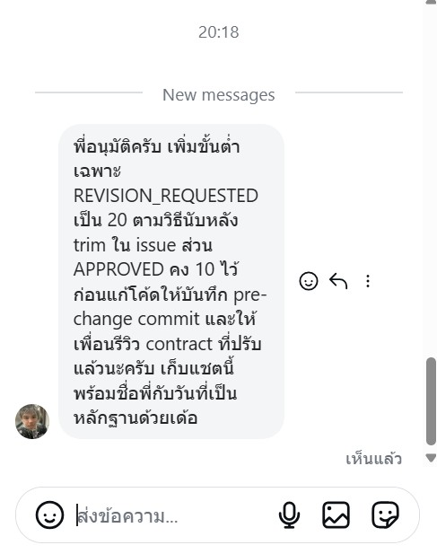

# Lab 7 approval record — CR-L7-01 / L7-E01

**Decision:** APPROVED by P'Tik (TA), **22 November 2026 at 20:18
Asia/Bangkok (UTC+07:00)**, equivalent to `2026-11-22T13:18:00Z`.
Work: [#85](https://github.com/Magiciancat9/Course_management/issues/85).

## Approved behavior and conditions

| Item | Recorded decision |
| --- | --- |
| Existing rule | Both APPROVED and REVISION_REQUESTED require `reviewFeedback.trim().length >= 10` |
| Approved change | Only REVISION_REQUESTED increases to **20** after trim, using the issue's JavaScript UTF-16 `String.length` method |
| Preserved rule | APPROVED stays at **10** after trim |
| Before code | Record the actual pre-change commit and have the teammate review the revised contract |
| Evidence retention | Keep the approval chat together with the TA's name and date |
| User confirmation | The user confirmed approval and instructed Codex to record the evidence and continue Lab 7 subject to these conditions |

The TA approved this bounded requirement change; approval does not claim
contract peer review, implementation, RED/GREEN, regression, release or
deployment. The review-before-code condition remains an active gate for #87.

## Original evidence and provenance

- Original supplied file: `PTIK_approve_for_lab7.jpg` (48,486 bytes).
- Repository copy: `evidence/ta-approval-20261122.jpg`, byte-for-byte original;
  no image editing, redrawing or translation is substituted for the screenshot.
- SHA-256: `eacc376597c7ee7607095344224a01a0bed9310b53a07b1a4c7f39cbaef1eae5`.
- The screenshot visibly supports the message, thresholds, prerequisites and
  time **20:18**. The approver's name **P'Tik (TA)** and calendar date
  **22/11/2026 (d/m/y)** were supplied explicitly by the user in the same
  working conversation; they are not claimed to be visible in the image.
- Codex received the evidence from the user and transcribed it; Codex did not
  contact the TA or independently observe the original chat delivery.
- Preserve the original image, this provenance and the user's attribution in
  the final assessed PDF; attach a readable caption with evidence ID L7-E01.

### Exact supplied Thai text

> พี่อนุมัติครับ เพิ่มขั้นต่ำเฉพาะ REVISION_REQUESTED เป็น 20 ตามวิธีนับหลัง trim ใน issue ส่วน APPROVED คง 10 ไว้
>
> ก่อนแก้โค้ดให้บันทึก pre-change commit และให้เพื่อนรีวิว contract ที่ปรับแล้วนะครับ เก็บแชตนี้พร้อมชื่อพี่กับวันที่เป็นหลักฐานด้วยเด้อ

### English translation for the report

> Approved. Increase the minimum only for REVISION_REQUESTED to 20, using the
> post-trim counting method specified in the issue. Keep APPROVED at 10.
> Before changing code, record the pre-change commit and have your teammate
> review the revised contract. Retain this chat with my name and the date as
> evidence.

The English text is a translation, not a separately sent TA message.

## Sequence and next gate

1. Approval received at the time above; user confirms and authorizes progress.
2. [Pre-change checkpoint](pre-change-baseline.md) recorded before any runtime
   or test-source edit.
3. [Revised contract / impact / AC / STS](revised-contract.md) committed for
   substantive review by `martinvadre` under #86 / PR #105.
4. Only after actual accepted contract review, proceed to #87 test-only RED,
   implementation/GREEN, regression and reviewed delivery.

The original pending request remains available in the earlier Git history.
This record supersedes its pending TA/user-confirmation status; it does not
retroactively change historical preparation claims into approvals or tests.
