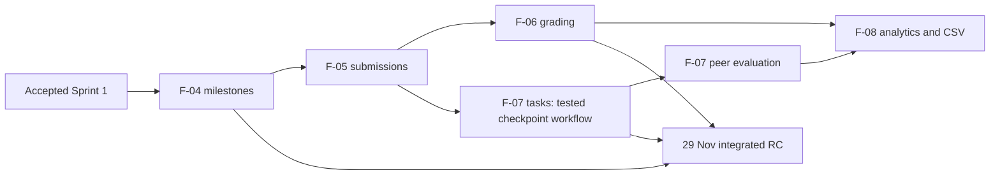

# Deliverable 2 — Sprint 2–3 engineering contracts

**25 Nov current snapshot (#100):** S2 implementation is independently
reviewed and deployed on main; F-07 tasks are reviewed/merged on Sprint 3
staging. Peer/analytics implementation remains planned. Accepted S2 tag/
authenticated release evidence and final combined main RC remain pending.

Read the [current version/result/finish register](continuity-and-status.md),
[complete requirement matrix](../../traceability.md) and [all 59 AC](verification-register.md).
The package is complete source for embedding, not a submitted PDF or final
acceptance. Historical documents keep their actual source/date/result scope.

D2 assessment mapping: Part A continuity/changes; Part B complete Sprint 2;
Part C Sprint 3 contracts/progress/remaining work; Part D full SRS/features/
System SDS/matrix/plan; Part E integrated RC/deployment. Legacy D1 section
letters in source filenames/headings do not define the D2 report structure.
[Full source/evidence map](continuity-and-status.md#6-assessed-parts-a-e-and-final-snapshot-gates).

## 1. Read and review in this order

| Document | Purpose / linked work |
| --- | --- |
| [Shared contract](shared-contract.md) | Common API, role/ownership, time, versioning, migration, error and DoD rules |
| [F-04 milestones](../sprint-2/f04-milestones.md) | FR-06; feature owner `martinvadre`; [#94](https://github.com/Magiciancat9/Course_management/issues/94) |
| [F-05 submissions](../sprint-2/f05-submissions.md) | FR-07 / BR-07; owner `Magiciancat9`; [#95](https://github.com/Magiciancat9/Course_management/issues/95) |
| [F-06 grading](../sprint-2/f06-grading.md) | FR-08 / BR-08; owner `martinvadre`; [#96](https://github.com/Magiciancat9/Course_management/issues/96) |
| [F-07 collaboration](../sprint-3/f07-collaboration.md) | FR-09/10; owner `Magiciancat9`; task checkpoint [#98](https://github.com/Magiciancat9/Course_management/issues/98), remaining peer work [#101](https://github.com/Magiciancat9/Course_management/issues/101) |
| [F-08 analytics/export](../sprint-3/f08-analytics-export.md) | FR-11/12; owner `martinvadre`; contracts [#99](https://github.com/Magiciancat9/Course_management/issues/99), remaining implementation [#102](https://github.com/Magiciancat9/Course_management/issues/102) |
| [UI refresh plan](../../ui-refresh-spec.md) | Screen changes, design tokens, Quick Fill removal, UIR-AC/STS; implemented in PR #110; integration verification in Sprint 2 ledger |
| [Continuity and checkpoint status](continuity-and-status.md) | Part A register / Part B–E status / remaining work; [#93](https://github.com/Magiciancat9/Course_management/issues/93), [#100](https://github.com/Magiciancat9/Course_management/issues/100) |
| [Detailed Lab 5–7 change/defect register](change-defect-register.md) | Accepted history, current disposition, owners, release/retest sources and concrete next actions for #93 |
| [Sprint 1 continuity execution evidence](sprint1-continuity-evidence.md) | Fresh tests on current staging, live commit/readiness checks and the remaining final-RC gate |
| [Verification register](verification-register.md) | Every new AC → planned test/level/file → implementation/execution status |
| [Complete traceability](../../traceability.md) | All baseline FR/BR/important NFR, actual Sprint 1 files and new planned checks |

Contracts include concrete clarified policies where the original SRS did not
specify an exact boundary. PR #107 records independent review before code. Any later
requirement change keeps its reason, reviewer and dated history. No review
or approval is inferred from this document's existence.

## 2. Confirmed ownership and review

| Member | Confirmed delivery responsibility |
| --- | --- |
| `Magiciancat9` | F-05, F-07; continuity, shared documentation/traceability and assessed PDF coordination; independent review of #106 UI implementation |
| `martinvadre` | F-04, F-06, F-08; integrated RC/deployment; #106 UI refresh / Quick Fill removal implementation, reassigned by the user on 22 Nov 2026 |

UI specification authorship stays with `Magiciancat9`; `martinvadre` reviewed
the original specification through merged PR #107. See the
[UIR v1.1 ownership record](../../ui-refresh-spec.md) for the implementation
handoff. The assignment record itself was not implementation evidence; PR #110 and the
current per-AC register now identify actual UI implementation/checks and gaps.

This package's draft author is `Magiciancat9`, including drafts for the
teammate-owned features. `martinvadre` substantively reviewed these drafts in PR #107;
they are not presented as the teammate's authored/approved work. Subsequent
code PRs retain the opposite-member review rule. Do not self-approve or
self-merge a PR.

## 3. Checkpoint scope and order

- **29 November, 23:59 Asia/Bangkok:** all Sprint 2 features completed,
  reviewed, integrated and verified; full Sprint 3 contracts and at least one
  meaningful implemented/tested Sprint 3 workflow in a deployed main RC.
- Implemented/reviewed first Sprint 3 workflow (#120 on staging): approved-team task create/assign → status
  transition → persisted reload, plus actual backend foreign-team denial.
- Preserve the original accepted Sprint 2 main/tag even after adding Sprint 3.
- Exact remaining AC, owner, dependency and next action have target dates by
  **13 December**, accounting for examinations on 1–11 December.
- Contract drafting may proceed against reviewed interfaces while an
  implementation dependency is incomplete; acceptance requires the actual
  integrated dependency. A mock alone cannot prove persistence or completion.

## 4. Lab 7 boundary

Maintained main includes the approved, reviewed Lab 7 change: revision feedback
minimum 20, approval minimum 10 after trim/UTF-16. The Sprint 2 integration
preserves it and reruns the Lab 7 suites. Historical Lab 7 records retain
their actual dates/results and are not reused as Sprint 2 verification.

## 5. Revision / review record

| Revision | Date | Decision / evidence |
| --- | --- | --- |
| D2-SPEC v1.0 | 22 Nov 2026 | Initial complete draft, UI plan and planned verification; no new runtime behavior/test results |
| Independent contract review | 22 Nov 2026 | martinvadre approved and merged PR #107 (`8eea6f0`) before implementation |
| Sprint 2 release reconciliation | 25 Nov 2026 | All F-04/F-05/F-06 source/reviews, combined verification and pending main/tag gates in the release ledger |

The final assessed PDF must embed the complete required documents and
selected actual execution evidence. This repository package is the source;
the shared work plans and draft review PDFs stay outside public Git.
