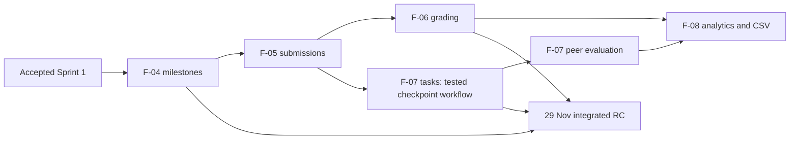

# Deliverable 2 — Sprint 2–3 engineering contracts

**Version:** D2-SPEC v1.0, 22 November 2026.
**Phase:** documentation only; proposed contracts awaiting independent review.
**Author:** Tatchakorn Thamnimitr (`Magiciancat9`).
**Requested reviewer:** Pawarit Wongdaeng (`martinvadre`).

Work board: [CoursePMS - Deliverable 2 (Sprint 2 & 3)](https://github.com/users/Magiciancat9/projects/8).
Feature ownership and Sprint fields remain on the existing issues. The UI
plan is tracked separately in [#106](https://github.com/Magiciancat9/Course_management/issues/106).

The user requested complete Sprint 2–3 specifications/acceptance criteria/STS
and a documented UI refresh before changing the application. This source
package specifies the planned work; it does not implement the features,
remove Quick Fill, change the database, execute new feature tests, or release
a candidate. An unexecuted test below is **PLANNED / NOT RUN**, never a pass.

## 1. Read and review in this order

| Document | Purpose / linked work |
| --- | --- |
| [Shared contract](shared-contract.md) | Common API, role/ownership, time, versioning, migration, error and DoD rules |
| [F-04 milestones](../sprint-2/f04-milestones.md) | FR-06; feature owner `martinvadre`; [#94](https://github.com/Magiciancat9/Course_management/issues/94) |
| [F-05 submissions](../sprint-2/f05-submissions.md) | FR-07 / BR-07; owner `Magiciancat9`; [#95](https://github.com/Magiciancat9/Course_management/issues/95) |
| [F-06 grading](../sprint-2/f06-grading.md) | FR-08 / BR-08; owner `martinvadre`; [#96](https://github.com/Magiciancat9/Course_management/issues/96) |
| [F-07 collaboration](../sprint-3/f07-collaboration.md) | FR-09/10; owner `Magiciancat9`; task checkpoint [#98](https://github.com/Magiciancat9/Course_management/issues/98), remaining peer work [#101](https://github.com/Magiciancat9/Course_management/issues/101) |
| [F-08 analytics/export](../sprint-3/f08-analytics-export.md) | FR-11/12; owner `martinvadre`; contracts [#99](https://github.com/Magiciancat9/Course_management/issues/99), remaining implementation [#102](https://github.com/Magiciancat9/Course_management/issues/102) |
| [UI refresh plan](../../ui-refresh-spec.md) | Screen changes, design tokens, Quick Fill removal, UIR-AC/STS; implementation deferred |
| [Continuity and checkpoint status](continuity-and-status.md) | Part A register / Part B–E status / remaining work; [#93](https://github.com/Magiciancat9/Course_management/issues/93), [#100](https://github.com/Magiciancat9/Course_management/issues/100) |
| [Detailed Lab 5–7 change/defect register](change-defect-register.md) | Accepted history, current disposition, owners, release/retest sources and concrete next actions for #93 |
| [Sprint 1 continuity execution evidence](sprint1-continuity-evidence.md) | Fresh tests on current staging, live commit/readiness checks and the remaining final-RC gate |
| [Verification register](verification-register.md) | Every new AC → planned test/level/file → implementation/execution status |
| [Complete traceability](../../traceability.md) | All baseline FR/BR/important NFR, actual Sprint 1 files and new planned checks |

Contracts are concrete proposals, including clarified policies where the SRS
did not specify an exact boundary. They become an implementation baseline
only after real teammate review records the accepted revision. Any later
requirement change keeps its reason, reviewer and dated history. No review
or approval is inferred from this document's existence.

## 2. Confirmed ownership and review

| Member | Confirmed delivery responsibility |
| --- | --- |
| `Magiciancat9` | F-05, F-07; continuity, shared documentation/traceability and assessed PDF coordination; independent review of #106 UI implementation |
| `martinvadre` | F-04, F-06, F-08; integrated RC/deployment; #106 UI refresh / Quick Fill removal implementation, reassigned by the user on 22 Nov 2026 |

UI specification authorship stays with `Magiciancat9`; `martinvadre` reviewed
the original specification through merged PR #107. See the
[UIR v1.1 ownership record](../../ui-refresh-spec.md) for the implementation
handoff. This assignment change does not mark any UI AC implemented/tested.

This package's draft author is `Magiciancat9`, including drafts for the
teammate-owned features. `martinvadre` must substantively review these drafts;
they are not presented as the teammate's authored/approved work. Subsequent
code PRs retain the opposite-member review rule. Do not self-approve or
self-merge a PR.

## 3. Checkpoint scope and order

- **29 November, 23:59 Asia/Bangkok:** all Sprint 2 features completed,
  reviewed, integrated and verified; full Sprint 3 contracts and at least one
  meaningful implemented/tested Sprint 3 workflow in a deployed main RC.
- Proposed first Sprint 3 workflow: approved-team task create/assign → status
  transition → persisted reload, plus actual backend foreign-team denial.
- Preserve the original accepted Sprint 2 main/tag even after adding Sprint 3.
- Exact remaining AC, owner, dependency and next action have target dates by
  **13 December**, accounting for examinations on 1–11 December.
- Contract drafting may proceed against reviewed interfaces while an
  implementation dependency is incomplete; acceptance requires the actual
  integrated dependency. A mock alone cannot prove persistence or completion.

## 4. Lab 7 boundary

Lab 7 [#85](https://github.com/Magiciancat9/Course_management/issues/85)
requests changing revision feedback from 10 to 20. The user reports sending
it to the TA; actual approval is still pending. This package keeps BR-05 at
**10 for both proposal decisions**. It neither implements nor approves the
separate maintenance change. Deliverable 2 contracts can proceed meanwhile.

## 5. Revision / review record

| Revision | Date | Decision / evidence |
| --- | --- | --- |
| D2-SPEC v1.0 | 22 Nov 2026 | Initial complete draft, UI plan and planned verification; no new runtime behavior/test results |
| Independent review | Pending | Record reviewer, PR permalink, date, accepted/revised policy IDs and resulting commit before implementation |

The final assessed PDF must embed the complete required documents and
selected actual execution evidence. This repository package is the source;
the shared work plans and draft review PDFs stay outside public Git.
