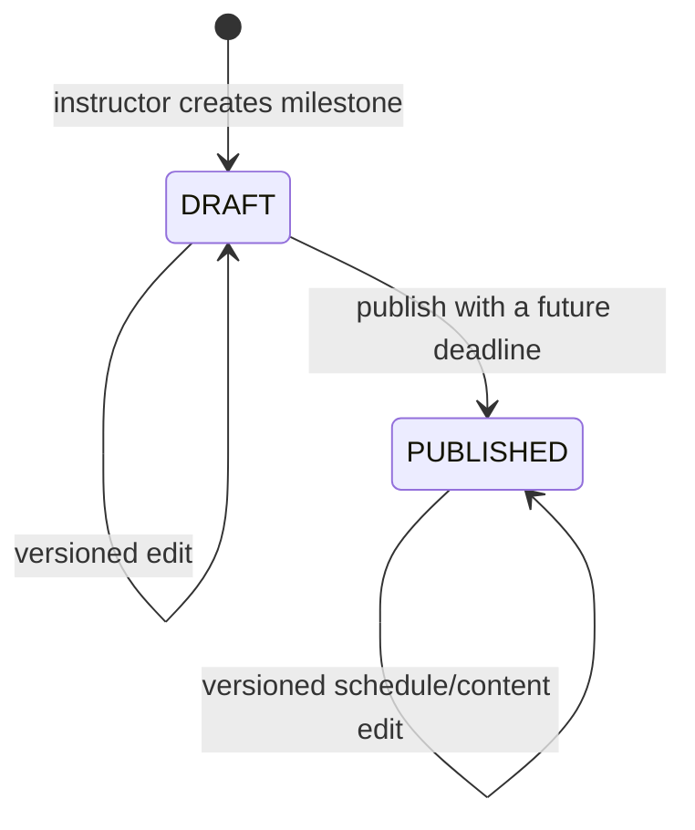

# F-04 — Course milestone definition and schedule management

**Contract:** S2-F04 v1.1, 25 Nov 2026; contract reviewed via PR #107 (`8eea6f0`), implementation PR pending review.
**Feature owner:** `martinvadre`; **draft author:** `Magiciancat9`; independent code reviewer: `Magiciancat9`. **Issue:** [#94](https://github.com/Magiciancat9/Course_management/issues/94).
**Links:** FR-06; NFR-01/02/04/05; F-01 dependency.
**Implementation / new tests / accepted release:** YES (branch `feat/94-f04-milestones`) / PASS (54 server, 26 client, 4 E2E) / PENDING SPRINT 2 RELEASE.

The [shared contract](../deliverable-2/shared-contract.md) supplies access,
time, error, transaction, migration and DoD conventions. This feature is
required in the completed Sprint 2 release, not deferred to Sprint 3.

## 1. Workflow and feature SDS



Students read published milestones; only instructors create/edit/publish.
There is no delete/unpublish endpoint in the baseline feature. A published
deadline edit governs future submissions; historical submission-version
deadline snapshots and lateness are preserved, not recalculated silently.

Planned modules: `server/src/routes/milestones.ts`,
`server/src/services/milestoneService.ts`, shared validation and Prisma;
`client/src/features/milestones/MilestoneManager.tsx` plus a student list.
Register routes before the existing unknown-API fallback. These paths do not
exist yet and may be versioned if implementation chooses different names.

## 2. UI contract

- Instructor Milestones page: course context, draft/published list, New
  milestone, edit form and explicit Publish action. Show title, description,
  deadline with timezone, weight and status; do not publish merely by saving.
- Student Milestones page: published milestones only, due date/weight and
  link to the owning team's submission when F-05 is implemented.
- Save/publish show pending text and prevent duplicate clicks. Errors preserve
  typed fields; a version conflict offers reload/reconcile instead of blind
  overwrite. Empty and unavailable course states remain distinct.

## 3. API and validation

| Method / route | Access | Request / response |
| --- | --- | --- |
| GET `/api/courses/:courseId/milestones` | Authenticated | Student sees published only; instructor may filter `status=DRAFT/PUBLISHED`. `{milestones, nextAfterId}` with shared pagination |
| GET `/api/milestones/:id` | Authenticated | Instructor sees existing draft/published; student sees published or 404. `{milestone}` |
| POST `/api/courses/:courseId/milestones` | Instructor | Create draft from fields below; 201 `{milestone}` with version 1 |
| PUT `/api/milestones/:id` | Instructor | `expectedVersion` plus ≥1 writable field; 200 `{milestone}`; version increments once |
| POST `/api/milestones/:id/publish` | Instructor | `{expectedVersion}`; draft→published; 200 `{milestone}` |

| Field | Definition / boundary |
| --- | --- |
| title | Required string, trimmed length 3–120 |
| description | Required string, trimmed length 10–5000 |
| dueDate | Required explicit-offset instant; store/return UTC. Drafts may hold a past date; publishing requires `dueDate > serverNow` |
| weightPercent | Required integer 0–100 inclusive; no invented course-wide sum=100 publication gate |
| expectedVersion | Required for edit/publish; shared integer/version rules |

A published edit may correct a valid deadline to a past or future instant;
it retains published status and original publishedAt, increments version and
does not rewrite earlier submission snapshots. UI explains the effect on
future writes. Other omitted fields stay unchanged. Payload `status`,
`courseId`, publisher or timestamps are not writable.

Example create body (synthetic course example):

```json
{"title":"Sprint 2 delivery","description":"Submit the reviewed release and report.","dueDate":"2026-11-29T23:59:00+07:00","weightPercent":20}
```

Errors: 400 `VALIDATION_ERROR` / `MILESTONE_DUE_DATE_INVALID`; 401 session;
403 `INSTRUCTOR_ROLE_REQUIRED`; 404 `COURSE_NOT_FOUND` /
`MILESTONE_NOT_FOUND`; 409 `MILESTONE_VERSION_CONFLICT` or
`MILESTONE_ALREADY_PUBLISHED`. Authorization precedes private validation.
After an uncertain create response, refresh/reconcile the catalogue rather
than automatically replaying non-idempotent POST.

## 4. Data and unaffected layers

Existing Milestone has course/title/description/dueDate/weightPercent. Add
status, publishedAt and version with an additive migration. Existing rows
must be inspected and mapped explicitly; do not silently publish legacy rows
or invent their publication time. Review migration/backfill under the shared
contract. No login, role enum, proposal transition or team-membership change
is needed: F-01/F-02/F-03 remain their existing implementations.

## 5. Numbered acceptance criteria

| AC ID | Criterion | Planned tests |
| --- | --- | --- |
| S2-F04-AC01 | Instructor creates a version-1 draft persisted and retrievable by a later request | S2-F04-T01 |
| S2-F04-AC02 | Invalid text/weight/date/type/unknown fields reject without a row or mutation | S2-F04-T02, S2-F04-T03 |
| S2-F04-AC03 | Draft publishes only with a strictly future due date; resulting status/time/version persist | S2-F04-T04 |
| S2-F04-AC04 | Instructor edits draft/published fields with expected version; past/future corrections preserve historical submission snapshots | S2-F04-T05, S2-F04-T06 |
| S2-F04-AC05 | Anonymous access is 401; students cannot mutate, discover drafts or bypass server authorization | S2-F04-T07 |
| S2-F04-AC06 | Concurrent stale edit/publish cannot overwrite newer state or publish twice | S2-F04-T08 |
| S2-F04-AC07 | Lists are course-scoped, published-only for students, deterministic/paginated; empty is not an error | S2-F04-T09 |
| S2-F04-AC08 | UI create/edit/publish and student readback honor pending/error/empty/conflict states | S2-F04-T10, S2-F04-T11 |

## 6. STS — all PLANNED / NOT RUN

Fixed clock `2026-11-22T00:00:00.000Z`; synthetic Instructor I, Student A1,
two courses and legacy/submitted fixtures from the shared contract.

| Test ID | Level | Inputs / preconditions | Expected result | AC |
| --- | --- | --- | --- | --- |
| S2-F04-T01 | I | Instructor creates valid draft; new GET/DB query | 201/version 1; all normalized fields match saved row; later GET matches | S2-F04-AC01 |
| S2-F04-T02 | U+I | Title 2/3/120/121; description 9/10/5000/5001; blank/null/wrong type | Exact minima/maxima accepted; outside/type failures 400 with unchanged DB | S2-F04-AC02 |
| S2-F04-T03 | U+I | Weight -1/0/100/101, fraction/string; malformed/offset-free date; extra status | Only integer 0–100 and valid offset date accepted; rejected body creates nothing | S2-F04-AC02 |
| S2-F04-T04 | U+I | Publish draft at due date now-1ms / now / now+1ms | First two 400; +1ms publishes, sets server publication time and increments once | S2-F04-AC03 |
| S2-F04-T05 | I | Edit a published deadline including a valid past correction; older version already submitted | New catalogue version/date saved; old submission due snapshot/late value identical | S2-F04-AC04 |
| S2-F04-T06 | I | Missing/wrong expectedVersion; stale version; same fields omitted | 400/409 as specified; omitted fields unchanged; later GET proves no lost write | S2-F04-AC04 |
| S2-F04-T07 | I | Anonymous GET/write; student direct POST/PUT/publish; draft GET | 401/403/404 respectively; no draft data or successful mutation | S2-F04-AC05 |
| S2-F04-T08 | I | Barrier-controlled concurrent edit/edit and publish/publish with same version | One valid transition; loser 409; version increments once per accepted write | S2-F04-AC06 |
| S2-F04-T09 | I | Other course, draft/published mix, empty list, limit/afterId boundaries | Correct visibility/context/page order; 200 empty; invalid paging 400 | S2-F04-AC07 |
| S2-F04-T10 | UI | Form validation, delayed save, API error and stale-version response | No duplicate save, preserved text, useful errors/reconcile; no false success | S2-F04-AC08 |
| S2-F04-T11 | E | Instructor creates/publishes; student signs in and reloads | Real published milestone/deadline visible; no draft leak | S2-F04-AC08 |

Planned files: U `server/tests/milestones.unit.test.ts`; I
`server/tests/milestones.integration.test.ts`; UI
`client/src/features/milestones/MilestoneManager.test.tsx`; E
`e2e/sprint2-milestones.spec.ts`. None is created/executed by this contract.

## 7. DoD / review history

Meet the shared DoD, including reviewed contract before code, genuine
RED/GREEN, real PostgreSQL/migration checks, every AC's actual result,
independent code review/CI and accepted Sprint 2 release. Rerun existing
authentication and proposal/team regression where shared code changes.

| Revision | Date / status |
| --- | --- |
| S2-F04 v1.0 | 22 Nov 2026; initial concrete proposal; reviewed and merged via PR #107 (`8eea6f0`) |
| S2-F04 v1.1 | 25 Nov 2026; RED integration tests committed at `18a1c0a` (9/9 failed 404); implemented Prisma additive migration, API/service, and UI on `feat/94-f04-milestones` |

## 8. AC completion & verification mapping (25 Nov 2026, Asia/Bangkok)

- **Contract → RED → GREEN trace:** Contract `8eea6f0` (22 Nov 2026) → RED `18a1c0a` (25 Nov 2026, 9/9 `milestones.integration.test.ts` failed behaviorally with HTTP 404) → GREEN on `feat/94-f04-milestones` (`54` server tests, `26` client tests, `4` Playwright E2E tests, client/server production builds PASS).
- **Populated-database migration check:** Applied `20261110000000_init` on disposable `course_pms_mig_test`, inserted a legacy `Milestone` row, resolved baseline (`prisma migrate resolve --applied 20261110000000_init`), and ran `prisma migrate deploy` (`20261125000000_f04_milestone_status_version`): legacy row preserved with `status = DRAFT`, `publishedAt = NULL`, `version = 1`, `weightPercent = 25`.

| AC ID | Test ID(s) | Actual file & test name | Result | Version / Scope |
| --- | --- | --- | --- | --- |
| S2-F04-AC01 | S2-F04-T01 | `server/tests/milestones.integration.test.ts` — `S2-F04-T01 (S2-F04-AC01)` | PASS | `feat/94-f04-milestones` (PostgreSQL `course_pms_test`) |
| S2-F04-AC02 | S2-F04-T02, S2-F04-T03 | `server/tests/milestones.unit.test.ts` & `server/tests/milestones.integration.test.ts` — `S2-F04-T02`, `S2-F04-T03` | PASS | `feat/94-f04-milestones` |
| S2-F04-AC03 | S2-F04-T04 | `server/tests/milestones.unit.test.ts` & `server/tests/milestones.integration.test.ts` — `S2-F04-T04` | PASS | `feat/94-f04-milestones` (fake clock `2026-11-22T00:00:00.000Z`) |
| S2-F04-AC04 | S2-F04-T05, S2-F04-T06 | `server/tests/milestones.integration.test.ts` — `S2-F04-T05`, `S2-F04-T06` | PASS | `feat/94-f04-milestones` |
| S2-F04-AC05 | S2-F04-T07 | `server/tests/milestones.integration.test.ts` — `S2-F04-T07` | PASS | `feat/94-f04-milestones` |
| S2-F04-AC06 | S2-F04-T08 | `server/tests/milestones.integration.test.ts` — `S2-F04-T08` | PASS | `feat/94-f04-milestones` |
| S2-F04-AC07 | S2-F04-T09 | `server/tests/milestones.integration.test.ts` — `S2-F04-T09` | PASS | `feat/94-f04-milestones` |
| S2-F04-AC08 | S2-F04-T10, S2-F04-T11 | `client/src/features/milestones/MilestoneManager.test.tsx` (`S2-F04-T10a–g`) & `e2e/sprint2-milestones.spec.ts` (`S2-F04-T11`) | PASS | `feat/94-f04-milestones` (Vitest + Chromium) |
