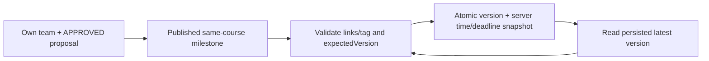

# F-05 — Team milestone deliverable submission

**Contract:** S2-F05 v1.0, 22 Nov 2026; proposed / review pending.
**Feature owner / draft author:** `Magiciancat9`; requested reviewer:
`martinvadre`. **Issue:** [#95](https://github.com/Magiciancat9/Course_management/issues/95).
**Links:** FR-07; BR-06/07; NFR-01/02/04/05. Dependencies: F-02/F-03 and
[F-04](f04-milestones.md). **Implemented / executed / accepted:** NO / NOT RUN / NONE.

## 1. Workflow and feature SDS

An own-team student with an APPROVED proposal selects a published milestone,
submits repository/tag/report/notes, then retrieves the saved work. Updating
creates a new immutable version. Late work is allowed and flagged, consistent
with the existing SRS. No new late-submission ban is introduced.

Planned modules: `server/src/routes/submissions.ts`,
`server/src/services/submissionService.ts`, Prisma transactional versioning;
`client/src/features/submissions/SubmissionWorkspace.tsx`. Respect the
[shared contract](../deliverable-2/shared-contract.md), especially time and
legacy migration. No upload/proxy/Git-provider integration is required.

## 2. UI contract

Student milestone detail shows requirements/deadline/timezone and eligibility.
An unapproved team gets an explanatory read-only prerequisite message, not a
fake successful submit. Eligible users edit repository URL, release tag,
report URL and notes; submission is explicit. Show current version, saved
timestamp and ON_TIME/LATE/UNKNOWN, with label "at time of submission".
Show only published grading for the current version under F-06.

Saving uses pending/disabled controls; success reads server-confirmed state.
Reload retrieves data; a stale version preserves typed text and asks the user
to reconcile. Changed content is not presented as retaining an old grade.

## 3. API, fields and errors

| Method / route | Access | Contract |
| --- | --- | --- |
| GET `/api/teams/:teamId/milestones/:milestoneId/submission` | Team member / instructor | 200 `{submission}` latest plus safe published evaluation summary; authorized no-record 404 |
| PUT same path | Own-team student | Create with expectedVersion 0 → 201; update with current version → 200 `{submission}` |
| GET `/api/teams/:teamId/milestones/:milestoneId/submission/versions` | Team member / instructor | Paginated `{versions, nextAfterId}`; historical content and that version's published grade only |
| GET `/api/courses/:courseId/milestones/:milestoneId/submissions` | Instructor | Paginated `{submissions, nextAfterId}` with real latest versions; no student course-wide access |

| Writable field | Definition |
| --- | --- |
| repoUrl | Required trimmed absolute HTTP(S) URL, maximum 2048 code units; represents existing artifactUrl in the current-row projection |
| reportUrl | Required on new versions; same URL validation. A legacy missing value stays explicitly unknown until a new valid version is submitted |
| releaseTag | Required trimmed string 1–128; no whitespace/control characters. Format/reference only; no claim that the remote tag actually exists |
| notes | Optional string, trimmed maximum 10000; absent becomes empty string |
| expectedVersion | 0 for first submission, current positive integer for update |

The server chooses team/course context from authorized resources, the new
version, submittedAt, dueDateSnapshot and lateStatus. Those values, scores
and grade feedback are not writable payload fields. Responses include IDs,
normalized content, current version, server timestamp, captured deadline,
lateStatus and current published evaluation or null.

Prerequisites: own membership; published milestone in the team's course;
current proposal APPROVED. Writes from an unapproved team return
409 `BR07_APPROVED_PROPOSAL_REQUIRED`. A draft milestone returns
409 `MILESTONE_NOT_PUBLISHED` for an otherwise authorized writer. Cross-course
resource mismatch is 404. Foreign-team access is 403; instructor write is
403. Invalid URL/tag/type/extra field is 400 `VALIDATION_ERROR`; missing
record/context is 404; stale create/update is 409
`SUBMISSION_VERSION_CONFLICT`.

## 4. Data, grading and concurrency

Use unique `(milestoneId, teamId)` and immutable `(submissionId, version)`.
Atomically update the current-row projection and create a content snapshot.
`lateStatus = LATE` only when the accepted server submittedAt is strictly
after its captured deadline; equality is ON_TIME. Inject the same fixed clock
and transaction snapshot in tests. Deadline edits do not rewrite history.

Resubmission is allowed by FR-07, including after an earlier grade. It creates
a new ungraded current version while retaining the old evaluation/history.
Never copy or overwrite a published grade onto changed content. F-06 must
reject a stale grade publication targeting a superseded version.

Existing records require additive reviewed migration and honest legacy
mapping; do not fabricate report URLs or historical lateness. Authentication,
team membership and proposal transitions need no behavior change.

## 5. Acceptance criteria

| AC ID | Criterion | Planned tests |
| --- | --- | --- |
| S2-F05-AC01 | Eligible own-team student creates one saved version and reads it on a later request/reload | S2-F05-T01, S2-F05-T11 |
| S2-F05-AC02 | Non-APPROVED proposal cannot submit; rejection leaves all saved state unchanged | S2-F05-T02 |
| S2-F05-AC03 | Only a published same-course milestone can receive the submission | S2-F05-T03 |
| S2-F05-AC04 | Required URLs/tag and all type/length/extra-field rules are enforced server-side | S2-F05-T04 |
| S2-F05-AC05 | Deadline equality is on time; after-deadline submission succeeds with LATE; client cannot forge timestamps/flag | S2-F05-T05 |
| S2-F05-AC06 | Updates create immutable versions; prior content/grades remain historical and the new version is ungraded | S2-F05-T06 |
| S2-F05-AC07 | Anonymous, instructor-write and foreign-team access are denied without data leakage/mutation | S2-F05-T07 |
| S2-F05-AC08 | Concurrent/retried stale writes cannot create duplicate logical rows or overwrite versions | S2-F05-T08 |
| S2-F05-AC09 | Historical deadline snapshots and legacy unknowns stay honest during migration/deadline edits | S2-F05-T09 |
| S2-F05-AC10 | UI pending/error/conflict/session boundaries preserve own draft and prevent foreign/stale state exposure | S2-F05-T10, S2-F05-T12 |

## 6. STS — PLANNED / NOT RUN

Shared synthetic fixtures: I; A1/A2 in approved Team A; Team D not approved;
Team B foreign; published M1, draft M2, other-course M3. Fixed clock/deadline.

| Test ID | Level | Inputs / preconditions | Expected result | AC |
| --- | --- | --- | --- | --- |
| S2-F05-T01 | I | A1 writes valid links/tag with version 0; independent GET/DB read | 201, one logical row/version 1; normalized fields and server metadata read back | S2-F05-AC01 |
| S2-F05-T02 | U+I | Proposal DRAFT/SUBMITTED/REVISION_REQUESTED versus APPROVED | First three 409 BR07; approved succeeds; rejected writes leave row count/content unchanged | S2-F05-AC02 |
| S2-F05-T03 | I | Draft milestone, wrong-course milestone, nonexistent ID | 409/404/404 as contracted; no submission/version inserted | S2-F05-AC03 |
| S2-F05-T04 | U+I | Blank/missing URLs/tag; HTTP/HTTPS vs FTP/javascript/relative; URL 2048/2049; tag 128/129; notes 10000/10001; unknown score key | Valid boundaries accepted; invalid payload 400, no mutation; no external URL fetch | S2-F05-AC04 |
| S2-F05-T05 | U+I | Server acceptance time deadline-1ms/equal/+1ms; forged submittedAt/isLate body | All valid requests save with ON_TIME/ON_TIME/LATE; forged fields 400; saved timestamp is server-derived | S2-F05-AC05 |
| S2-F05-T06 | I | Submit v1, publish its grade, update to v2 with current expected version | Immutable v1/grade retained; v2 latest/ungraded; no old score presented as grading new content | S2-F05-AC06 |
| S2-F05-T07 | I | Anonymous GET/PUT, B1 against Team A, instructor PUT, student course-wide list | 401/403 as specified, no private response fields or successful write | S2-F05-AC07 |
| S2-F05-T08 | I | Deterministic concurrent creates/updates and replay with stale expectedVersion | One accepted write per version, loser 409, unique logical row and contiguous accepted versions | S2-F05-AC08 |
| S2-F05-T09 | I | Populated legacy migration; F-04 changes deadline during versioned submission | IDs/content preserved, unknown metadata not invented; accepted deadline/late fields come from one consistent snapshot | S2-F05-AC09 |
| S2-F05-T10 | UI | Delayed save, network/400/409, unapproved/draft prerequisite | Disabled duplicate action; text retained; clear error/reconcile; no fake success | S2-F05-AC10 |
| S2-F05-T11 | E | Actual approved team submits then reloads; instructor views saved version | Real persistence and same normalized content/version/timestamp; valid late flag | S2-F05-AC01 |
| S2-F05-T12 | UI+E | A request pending; logout/switch to B or 401; A response finishes late | A private data/drafts cleared; no stale result changes B data or pending state | S2-F05-AC10 |

Planned files: U `server/tests/submissions.unit.test.ts`; I
`server/tests/submissions.integration.test.ts`; UI
`client/src/features/submissions/SubmissionWorkspace.test.tsx`; E
`e2e/sprint2-submissions.spec.ts`. None is created or run by this document.

## 7. DoD and version history

Meet shared DoD and all ten AC; retain full required fields/real DB readback,
BR-07 and API ownership evidence, genuine RED/GREEN, additive populated-data
migration checks, independent review/CI and accepted Sprint 2 version. Test
integration with F-04 updates and F-06 grade/version binding. Contract
drafting may proceed before #94 completes; implementation acceptance may not
claim the integrated dependency is complete while it remains unverified.

| Revision | Date / status |
| --- | --- |
| S2-F05 v1.0 | 22 Nov 2026; proposed late/version/URL policy; teammate review pending; implementation/tests NOT RUN |
