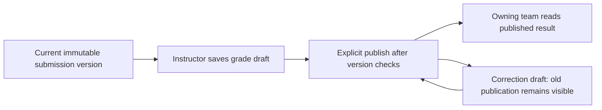

# F-06 — Instructor grading and rubric feedback

**25 Nov current reconciliation (#100):** implementation independently
reviewed/merged via PR #118, integrated/deployed on main through PR #119.
The complete contract/AC/STS below is retained; [per-AC actual verification](../deliverable-2/verification-register.md)
and [current release register](../deliverable-2/continuity-and-status.md)
separate tested implementation from #97's remaining accepted-tag/authenticated
release gates. Original pre-code and feature-head execution claims stay dated.

**25 Nov integration update (#97):** feature implementations were independently
reviewed and merged in PR #116/#117/#118. The feature-head history below retains
its original scope; [accepted-release.md](accepted-release.md) records the
combined maintained-main candidate, all Sprint 2 AC and pending release gates.

**Contract:** S2-F06 v1.1, 25 Nov 2026; contract reviewed via PR #107 (`8eea6f0`), implementation independently reviewed and merged via PR #116.
**Feature owner:** `martinvadre`; draft author `Magiciancat9`; independent code reviewer `Magiciancat9`. **Issue:** [#96](https://github.com/Magiciancat9/Course_management/issues/96).
**Links:** FR-08, BR-06/08, NFR-01/02/04; depends on [F-05](f05-submissions.md) (PR #117 / `88fb036`).
**Implemented / executed / accepted:** YES (branch `feat/96-f06-grading`) / PASS (93 server, 41 client, 6 E2E) / PENDING SPRINT 2 RELEASE.

## 1. Workflow and feature SDS

Instructor opens a real submitted version, records a bounded score and
written feedback as a draft, then explicitly publishes it. Students see only
the latest published evaluation for their authorized submission version.
The product records the instructor's rubric outcome; it does not introduce a
new multi-criterion rubric-designer subsystem absent from the baseline.

Planned modules: `server/src/routes/grading.ts`,
`server/src/services/gradingService.ts`, evaluation/publication models;
`client/src/features/grading/GradingConsole.tsx` and owning-team feedback
summary. Apply the [shared contract](../deliverable-2/shared-contract.md).

## 2. UI contract

- Instructor list/filter of actual submitted work shows team, milestone,
  submission version and ungraded/draft/published state. The detail links the
  exact artifact/report/tag being graded; never hide the version binding.
- Separate Save grading draft and Publish grade. Show score range and feedback
  validation, pending state, explicit publication confirmation and conflict
  recovery. Do not auto-publish on input blur or draft save.
- Owning student sees published score/feedback/time/version only. Editing an
  instructor correction draft must not leak its score into student UI.
- New submission content is ungraded until its own evaluation is published;
  historical published feedback stays available in authorized history.

## 3. API / validation / errors

| Method / path | Access | Request / result |
| --- | --- | --- |
| GET `/api/submissions/:id/evaluation?submissionVersion=n` | Own-team member / instructor | Optional version defaults to current. Instructor gets `{evaluation:{draft,published,...versions}}`; student gets `{evaluation: publishedSnapshotOrNull}` only |
| PUT `/api/submissions/:id/evaluation` | Instructor | `{submissionVersion, expectedVersion, score, feedback}`; create draft with expectedVersion 0 → 201, update current draft → 200 |
| POST `/api/submissions/:id/evaluation/publish` | Instructor | `{submissionVersion, expectedVersion}`; validate current content/draft; 200 instructor evaluation DTO |

- `submissionVersion`: positive integer, must be the current content version
  for writes/publication. Valid but superseded content → 409
  `STALE_SUBMISSION_VERSION` without publishing a grade for newer work.
- `score`: required integer **0–100 inclusive**, matching existing Int design.
  Reject null, fractions, strings, -1 and 101 with 400 `VALIDATION_ERROR`.
- `feedback`: required trimmed string **1–2000**; blank/wrong type rejected.
  The proposal BR-05 approval10/revision20 rule is for a different field;
  grading feedback retains its reviewed 1-2000 rule. F-06 does not alter
  maintained main's approved Lab 7 proposal rule.
- New draft starts resource version 1 / draftRevision 1. Expected-version
  errors follow common 400/409 rules (`GRADE_VERSION_CONFLICT`). Unauthorized
  student mutation is 403, anonymous 401, foreign-team read 403, authorized
  missing submission/version 404. Unknown payload keys are 400.
- Publishing an already-published unchanged draft returns 409
  `GRADE_ALREADY_PUBLISHED`, without another publication or timestamp.

## 4. Data, history and atomicity

Use one evaluation aggregate per `(submissionId, submissionVersion)` and
immutable GradePublication snapshots unique by evaluation/draftRevision.
The aggregate resource version increments on each accepted save/publish;
draftRevision increments only when draft content is saved. A publication
records the current draftRevision, score/feedback, actor and server time.

Example: save gives version 1/draftRevision 1; publish gives resource version
2 and publication for draft 1. Correction save gives version 3/draft 2 while
students still read publication 1. Publishing draft 2 gives version 4 and a
new immutable publication; prior publication history is preserved.

Publish checks the submission's current content version and grade version
inside the transaction. A concurrent submission update yields either a
legitimate publication for the then-current old version or a stale-version
409; it must never attach that grade to the new version. Student DTOs and
F-08 use the latest publication for the current content version, not a draft
or the old version's score. Existing `score`/`feedback` legacy fields remain
preserved/mapped under the common migration policy; do not invent their
publication metadata. Authentication and proposal/team behavior need no change.

## 5. Acceptance criteria

| AC ID | Criterion | Planned tests |
| --- | --- | --- |
| S2-F06-AC01 | Instructor saves a valid draft evaluation of actual current submitted content and retrieves it | S2-F06-T01 |
| S2-F06-AC02 | Score 0/100 accepted; out-of-range/fraction/string/null rejected without mutation | S2-F06-T02 |
| S2-F06-AC03 | Feedback trim/type/length and unknown-field checks are enforced independently of UI | S2-F06-T03 |
| S2-F06-AC04 | Explicit publication persists correct version, score, feedback, actor and time; duplicate publication is not duplicated | S2-F06-T04 |
| S2-F06-AC05 | Students see only their team's published data, never a draft or foreign grade; student writes and anonymous access denied | S2-F06-T05 |
| S2-F06-AC06 | A correction draft preserves the previous publication until republished; immutable history remains inspectable | S2-F06-T06 |
| S2-F06-AC07 | A new content version is ungraded and stale/concurrent publication cannot grade the wrong work | S2-F06-T07, S2-F06-T08 |
| S2-F06-AC08 | UI draft/publish/error/conflict states prevent duplicate actions and false publication | S2-F06-T09 |
| S2-F06-AC09 | End-to-end instructor publication and authorized student reload reflect actual persisted current-version grade | S2-F06-T10, S2-F06-T11 |

## 6. Original reviewed STS (actual execution in current register)

Fixtures: I, second instructor I2, owning A1 and foreign B1; current submitted
version v1, newer v2 and a missing submission. Shared fixed clock/DB fixtures.

| Test ID | Level | Inputs / preconditions | Expected result | AC |
| --- | --- | --- | --- | --- |
| S2-F06-T01 | I | I saves score 75/valid feedback with content v1 and expectedVersion 0; new GET/DB query | 201 draft/version 1; normalized values persisted; student still sees null | S2-F06-AC01 |
| S2-F06-T02 | U+I | Scores -1/0/100/101, 1.5, string, null | Only integer boundaries/interior accepted; rejected writes preserve prior row/publication | S2-F06-AC02 |
| S2-F06-T03 | U+I | Feedback blank, length 1/2000/2001, wrong type; extra publisher field | Valid boundaries accepted; invalid body 400; identity/time never client-controlled | S2-F06-AC03 |
| S2-F06-T04 | I | Publish current draft then repeat with stale/current unchanged draft | One publication, server actor/time, correct v1 binding; duplicate/stale 409 with no extra history | S2-F06-AC04 |
| S2-F06-T05 | I | A1/B1 GET, student PUT/publish, anonymous requests; draft contains distinctive private text | Own student gets published-only/null, foreign 403, writes 403, anonymous 401; no draft leakage | S2-F06-AC05 |
| S2-F06-T06 | I | Publish 70; save correction 80 without publish; then publish correction | Student sees 70 until explicit republish then 80; two historical publications retained | S2-F06-AC06 |
| S2-F06-T07 | I | Publish v1; submit v2; attempt publication using v1 | Current v2 evaluation null/ungraded; stale publication 409; v1 history not rewritten | S2-F06-AC07 |
| S2-F06-T08 | I | Barriers: I/I2 same expected grade version; publish races F-05 content update | One accepted grade transition per version; no lost update/duplicate publication or grade carried to new content | S2-F06-AC07 |
| S2-F06-T09 | UI | Draft save versus publish; delayed/error/409; session switch | No premature public success/double action; preserved same-session input and cleared stale-session data | S2-F06-AC08 |
| S2-F06-T10 | E | Instructor records/publishes grade; A1 signs in/reloads; B1 direct API access | Correct real saved publication for A1, denied B1, no draft state exposed | S2-F06-AC09 |
| S2-F06-T11 | I | Upgrade legacy score/feedback rows; later new-version grade readback | Original values/IDs preserved; unverifiable publication not invented; accepted new publication reads back accurately | S2-F06-AC09 |

Planned files: U `server/tests/grading.unit.test.ts`; I
`server/tests/grading.integration.test.ts`; UI
`client/src/features/grading/GradingConsole.test.tsx`; E
`e2e/sprint2-grading.spec.ts`. These tests are not created/run by this draft.

## 7. DoD / review history

Shared DoD plus all AC, real DB score/publication/history checks, current
submission-version races, direct backend negative tests and actual UI/E2E
readback. Retain reviewed pre-code contract, RED/GREEN, actual file/test/results,
teammate-reviewed PR/CI and accepted Sprint 2 release. No required grading work
is silently moved to Sprint 3.

| Revision | Date / status |
| --- | --- |
| S2-F06 v1.0 | 22 Nov 2026; initial draft with proposed publication/version rules; reviewed and merged via PR #107 (`8eea6f0`) |
| S2-F06 v1.1 | 25 Nov 2026; RED integration tests committed at `b2933bc` (9/9 failed 404); implemented Prisma additive migration (`20261125020000_f06_grading_publications`), grading service/routes, F-05 `publishedEvaluation` wiring, and `GradingConsole` UI on `feat/96-f06-grading` |

## 8. AC completion & verification mapping (25 Nov 2026, Asia/Bangkok)

- **Contract → RED → GREEN trace:** Contract `8eea6f0` (22 Nov 2026) → F-05 integration base `88fb036` (PR #117) → RED `b2933bc` (25 Nov 2026, 9/9 `grading.integration.test.ts` failed behaviorally with HTTP 404) → GREEN on `feat/96-f06-grading` (`93` server tests across 11 files, `41` client tests across 8 files, `6` Playwright E2E tests, client/server production builds PASS).

| AC ID | Test ID(s) | Actual file & test name | Result | Version / Scope |
| --- | --- | --- | --- | --- |
| S2-F06-AC01 | S2-F06-T01 | `server/tests/grading.integration.test.ts` — `S2-F06-T01 (S2-F06-AC01)` | PASS | `feat/96-f06-grading` (PostgreSQL `course_pms_test`) |
| S2-F06-AC02 | S2-F06-T02 | `server/tests/grading.unit.test.ts` & `server/tests/grading.integration.test.ts` — `S2-F06-T02` | PASS | `feat/96-f06-grading` |
| S2-F06-AC03 | S2-F06-T03 | `server/tests/grading.unit.test.ts` & `server/tests/grading.integration.test.ts` — `S2-F06-T03` | PASS | `feat/96-f06-grading` |
| S2-F06-AC04 | S2-F06-T04 | `server/tests/grading.integration.test.ts` — `S2-F06-T04 (S2-F06-AC04)` | PASS | `feat/96-f06-grading` (fake clock `2026-11-26T09:30:00.000Z`) |
| S2-F06-AC05 | S2-F06-T05 | `server/tests/grading.integration.test.ts` — `S2-F06-T05 (S2-F06-AC05)` | PASS | `feat/96-f06-grading` |
| S2-F06-AC06 | S2-F06-T06 | `server/tests/grading.integration.test.ts` — `S2-F06-T06 (S2-F06-AC06)` | PASS | `feat/96-f06-grading` |
| S2-F06-AC07 | S2-F06-T07, S2-F06-T08 | `server/tests/grading.integration.test.ts` — `S2-F06-T07`, `S2-F06-T08` | PASS | `feat/96-f06-grading` |
| S2-F06-AC08 | S2-F06-T09 | `client/src/features/grading/GradingConsole.test.tsx` — `S2-F06-T09a–e` | PASS | `feat/96-f06-grading` (Vitest) |
| S2-F06-AC09 | S2-F06-T10, S2-F06-T11 | `e2e/sprint2-grading.spec.ts` (`S2-F06-T10`), `server/tests/grading-migration.integration.test.ts` & `server/tests/grading.integration.test.ts` (`S2-F06-T11`) | PASS | `feat/96-f06-grading` (Chromium + PostgreSQL) |
