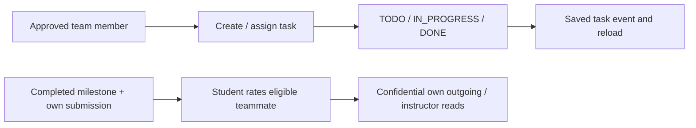

# F-07 — Team sprint tasks and confidential peer evaluation

**Contract:** S3-F07 v1.0, 22 Nov 2026; independently reviewed via PR #107 before implementation.
**Owner / author:** `Magiciancat9`; independent implementation reviewer `martinvadre`.
**Issues:** [#98 checkpoint](https://github.com/Magiciancat9/Course_management/issues/98),
[#101 remaining peer work](https://github.com/Magiciancat9/Course_management/issues/101).
**Links:** FR-09/10; BR-06/08; NFR-01/02/04. Dependencies: F-02 and
[F-05 milestone/submission context](../sprint-2/f05-submissions.md).
**25 Nov task checkpoint:** AC01-06 implemented on `feat/98-f07-tasks`;
[execution ledger](f07-execution-evidence.md) records exact tests/results.
AC07-12 peer evaluation remains NOT IMPLEMENTED / NOT RUN under #101.
No accepted Sprint 3 release is claimed.

## 1. Scope and feature SDS

The in-application task board is a team collaboration feature, distinct from
the team's GitHub project-management board. Any current student member of an
APPROVED team may create/assign/update its tasks. Contributors and changes
are attributable through saved task events. Instructor access is read-only.

Peer evaluation is a separate confidential workflow for a completed milestone.
Under proposed DD-S3-01, completed means: published milestone, server time
at/after dueDate, and this team has a real saved submission. A grade need not
exist first. Do not infer completion from a checkbox or an empty screen.

Planned modules: `server/src/routes/tasks.ts`, `peerEvaluations.ts`,
`server/src/services/taskService.ts`, `peerEvaluationService.ts`, related
models; client `features/collaboration/TaskBoard.tsx` and `PeerEvaluation.tsx`.
Apply the [shared contract](../deliverable-2/shared-contract.md).

## 2. UI and workflow boundaries

- Task page: accessible TODO/IN_PROGRESS/DONE columns or equivalent status
  controls, own-team member assignee selection, sprint filter, optional
  milestone, clear empty state, pending/save/conflict feedback and event log.
  Dragging must have an equivalent keyboard action; not drag-only.
- Any status may change directly to another defined status, including DONE
  back to TODO. No extra mandatory transition order is invented by FR-09.
- Peer page: eligible other teammates only; rating 1–5 and optional comment;
  show the author's own saved outgoing entries. Do not expose incoming
  comments/ratings, evaluator identities or who else submitted to students.
- Instructor may inspect team task/event and peer records through authorized
  read paths; may not impersonate a student rating or mutate student tasks.
- Optional task milestone uses the same course's published milestone. A
  task does not require an already-submitted deliverable: F-05 is a context
  dependency, not a new task eligibility rule beyond APPROVED membership.

## 3. API and data definitions

| Method / route | Access | Request / response |
| --- | --- | --- |
| GET `/api/teams/:teamId/tasks` | Team member / instructor | Filter sprintNumber/milestoneId/status; shared pagination; `{tasks,nextAfterId}` |
| POST `/api/teams/:teamId/tasks` | Own approved-team student | Task create fields below; 201 `{task}` |
| PUT `/api/tasks/:taskId` | Own approved-team student | `expectedVersion` plus ≥1 writable task field; 200 `{task}` |
| GET `/api/tasks/:taskId/events` | Team member / instructor | Paginated `{events,nextAfterId}`; actual actor/change/time/version |
| GET `/api/teams/:teamId/milestones/:milestoneId/peer-evaluations/me` | Own-team student | Only this authenticated author's outgoing evaluations; `{evaluations,nextAfterId}` |
| PUT `/api/teams/:teamId/milestones/:milestoneId/peer-evaluations/:evaluateeId` | Own-team student | `{expectedVersion,rating,comment?}`; create 201 / update 200 `{evaluation}` |
| GET `/api/teams/:teamId/milestones/:milestoneId/peer-evaluations` | Instructor only | Paginated confidential `{evaluations,nextAfterId}` |

Task fields: title trimmed **3–120**, optional description trimmed **≤5000**;
`sprintNumber` integer **1–3**; `status` one of TODO/IN_PROGRESS/DONE (create
defaults TODO); nullable `assigneeId` must be a current member of that team;
optional milestoneId must be published and in the team's course. Create uses
`expectedVersion:0`; update uses the current version. Team/course/author and
timestamps are server-derived. Resource version starts 1; accepted changes
atomically append one immutable TaskEvent (including creation) with actor,
changed fields and server time. No delete feature is added here.

Peer fields: integer rating **1–5**; optional trimmed comment **≤2000**; create
expectedVersion 0, update current version. Evaluator identity is always the
authenticated student, never a body field. Unique
`(milestoneId,evaluatorId,evaluateeId)` prevents duplicate pair ratings. Only
the author may edit their own evaluation; instructor reads do not grant write.
No new peer deadline after the completion boundary is introduced.

## 4. Prerequisites, errors and confidentiality

- Task writes from a non-APPROVED team: 409 `APPROVED_TEAM_REQUIRED`. Reads
  remain own-team/instructor, preserving authorized historical records.
- Invalid task assignee/context: 400 `INVALID_TASK_ASSIGNEE` / validation or
  404 context mismatch; invalid status/field/type/range: 400; stale version:
  409 `TASK_VERSION_CONFLICT`. No state/event is written on rejection.
- Peer before completion or without own submission: 409
  `MILESTONE_NOT_COMPLETED`; self-rating: 400 `SELF_EVALUATION_NOT_ALLOWED`;
  non-teammate evaluatee: 400 `INVALID_PEER_TARGET`; stale pair version: 409
  `PEER_EVALUATION_VERSION_CONFLICT`.
- Anonymous 401; foreign-team access and forbidden role operations 403.
  Student collection reads of all peer records are 403 even for their own
  team. General team/course/task DTOs never contain peer feedback.
- If a deadline is extended after an evaluation, historical authorized reads
  still work; new writes must satisfy the current completion boundary.
- Do not automatically turn a peer rating into a grade adjustment. No such
  calculation is in the agreed baseline.

Data additions: Task, TaskEvent, PeerEvaluation and related FKs/unique keys
from the shared design. Preserve existing team/proposal/auth schema and data;
no changed proposal-review rule or GitHub integration is needed.

## 5. Acceptance criteria

| AC ID | Criterion | Planned tests |
| --- | --- | --- |
| S3-F07-AC01 | Approved-team member creates a task with eligible assignee/sprint and retrieves persisted state | S3-F07-T01 |
| S3-F07-AC02 | Task validation, same-course published context and non-approved write prerequisite are enforced | S3-F07-T02 |
| S3-F07-AC03 | Any allowed status transition/reopen persists and appends exactly one attributed event per accepted version | S3-F07-T03 |
| S3-F07-AC04 | Foreign-team task/event access, anonymous access and instructor task mutations are denied | S3-F07-T04 |
| S3-F07-AC05 | Stale/concurrent task updates cannot overwrite or duplicate events; filters/pagination are correct | S3-F07-T05, S3-F07-T06 |
| S3-F07-AC06 | Accessible task create/assign/transition/reload works as meaningful checkpoint progress with session isolation | S3-F07-T07, S3-F07-T08 |
| S3-F07-AC07 | Peer writes require the defined completed milestone and own saved submission | S3-F07-T09 |
| S3-F07-AC08 | Rating/comment bounds and no-self-rating/eligible-teammate rules are enforced server-side | S3-F07-T10 |
| S3-F07-AC09 | Author can save/update/read only their own outgoing pair; uniqueness and history metadata persist | S3-F07-T11 |
| S3-F07-AC10 | Other students cannot read incoming/others' peer details; instructor reads are authorized; no DTO leak | S3-F07-T12 |
| S3-F07-AC11 | Concurrent peer updates preserve one pair and expected-version semantics without partial writes | S3-F07-T13 |
| S3-F07-AC12 | Peer UI reflects actual eligibility/save/error states and reloads confidential persisted outgoing feedback | S3-F07-T14, S3-F07-T15 |

## 6. Reviewed STS (original pre-code design)

I; A1/A2 approved Team A; D1 draft Team D; B1 foreign; published M1 due at
fixed instant, draft/wrong-course milestones; own/foreign submission variants.

| Test ID | Level | Inputs / preconditions | Expected result | AC |
| --- | --- | --- | --- | --- |
| S3-F07-T01 | I | A1 creates valid task assigned to A2, sprint 3; independent GET/DB read | 201/version 1; own fields, assignee and creation event persist | S3-F07-AC01 |
| S3-F07-T02 | U+I | Title 2/3/120/121; description 5000/5001; sprint 0/1/3/4; invalid status/type/assignee; draft/wrong-course milestone; draft team | Valid bounds accepted; 400/404/409 as specified; no task/event inserted on failure | S3-F07-AC02 |
| S3-F07-T03 | I | A2 updates A1 task TODO→IN_PROGRESS→DONE→TODO using fresh versions | Status/last actor correct; one immutable event per accepted version and earlier events unchanged | S3-F07-AC03 |
| S3-F07-T04 | I | B1 task/list/event GET/PUT, anonymous, instructor POST/PUT | 403/401 by role/ownership; no private fields, state change or new event | S3-F07-AC04 |
| S3-F07-T05 | I | Barrier-controlled two writes with same expectedVersion; stale replay | One success and one 409; no lost update or duplicated event | S3-F07-AC05 |
| S3-F07-T06 | I | Task filters and empty team; limit/afterId edges and other-course context | Correct own-team deterministic page/empty 200; invalid values 400; no foreign task rows | S3-F07-AC05 |
| S3-F07-T07 | UI | Keyboard status/assignee actions, delayed/error/409 save, identity switch | Equivalent keyboard operation; no duplicate/false save; draft retained in same session, cleared across users | S3-F07-AC06 |
| S3-F07-T08 | E | Approved-team create/assign/status then reload; direct B1 denial | Real saved lifecycle and permission rejection demonstrated in candidate | S3-F07-AC06 |
| S3-F07-T09 | U+I | Time due-1ms/equal/+1ms; own submission absent/present; draft milestone | Only published, at/after deadline with own saved submission qualifies; otherwise 409 with unchanged rows | S3-F07-AC07 |
| S3-F07-T10 | U+I | Ratings 0/1/5/6/fraction/string; self A1; foreign target B1; comments 2000/2001 | Valid bounds pass; self/target/validation 400; no peer write on rejection | S3-F07-AC08 |
| S3-F07-T11 | I | A1 rates A2, reads own /me, updates with current version | One pair row, evaluator server-derived, normalized values/version persist; no duplicate create | S3-F07-AC09 |
| S3-F07-T12 | I | A2 requests A1 outgoing/incoming records; student collection; I read; general DTOs | Other-student/all-peer access 403; I authorized; no private peer payload embedded in other resources | S3-F07-AC10 |
| S3-F07-T13 | I | Concurrent create/update same evaluator/evaluatee/milestone version | Unique pair, one accepted version, loser 409; no overwritten confidential feedback | S3-F07-AC11 |
| S3-F07-T14 | UI | Eligibility locked/unlocked; validation/pending/network/conflict and account switch | Correct prerequisite and saved status; no incoming disclosure or stale-user data | S3-F07-AC12 |
| S3-F07-T15 | E | A1 saves feedback after completion and reloads; A2 cannot fetch it; I can inspect | Real confidential persisted readback and direct backend denial; no automatic grade adjustment | S3-F07-AC12 |

Planned files: U `server/tests/collaboration.unit.test.ts`; I
`server/tests/collaboration.integration.test.ts`; UI
`client/src/features/collaboration/Collaboration.test.tsx`; E
`e2e/sprint3-collaboration.spec.ts`. Task U/I/UI/E files now exist; exact task execution is in the linked ledger.
Peer tests T09-T15 remain NOT CREATED / NOT RUN.

## 7. Checkpoint and final DoD / history

By 29 Nov all F-07 contracts/AC/STS must be reviewed; implement and test the
task lifecycle AC01–06 as the proposed meaningful progress. Do not close all
F-07 scope by claiming those task checks cover peer evaluation. #101 tracks
AC07–12 and unachieved task AC to an exact final plan (proposed target 5 Dec).
Feature acceptance still requires all AC, shared DoD, real persistence/access,
reviewed integration and final release evidence.

| Revision | Date / status |
| --- | --- |
| S3-F07 v1.0 | 22 Nov 2026; complete task/peer draft and proposed completion/rating policy; reviewed by martinvadre in PR #107 (`8eea6f0`), before implementation |
| Task checkpoint, 25 Nov 2026 | RED `c03ff7733719a5cda5af1acfd34ac707133661b0`, then additive task API/UI/migration; execution ledger maps AC01-06. Peer AC07-12 remain #101, owner Magiciancat9, target 5 Dec 2026. Independent code review and staging merge complete via #120; main RC pending #103. |
