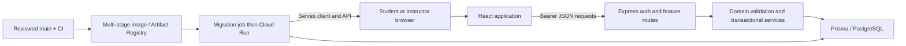
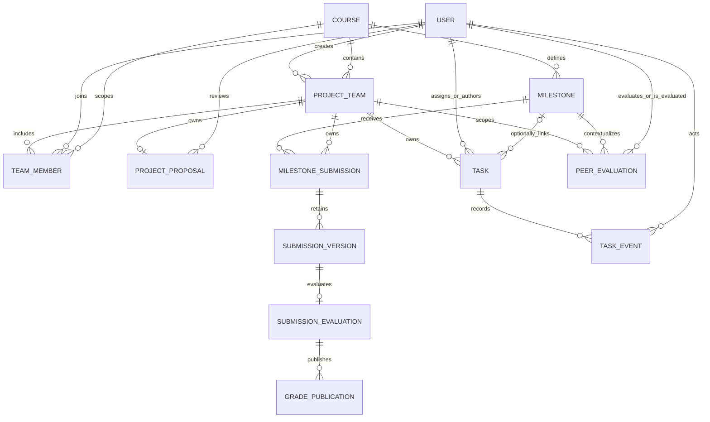

# System-Level Software Design Specification

**Current source:** 25 Nov 2026 #100 snapshot plus #101 peer candidate. The
[version/release register](sprints/deliverable-2/continuity-and-status.md)
distinguishes deployed S2-MAIN from reviewed S3-TASK staging and future RC.
F-01 through F-06 and F-07 tasks are implemented/reviewed. The #101 feature
candidate adds implemented/tested confidential peer evaluation, pending
independent review/integration; F-08 remains a reviewed unimplemented design. Baseline FR/BR/NFR
scope remains in [SRS](srs.md); complete per-feature contracts retain their
numbered AC/STS and shared DoD.

## 1. Architecture and responsibility

| Layer | Actual responsibility / source |
| --- | --- |
| React 18 / TypeScript / Vite | `client/src/App.tsx` authenticates, owns session boundaries and team/proposal screens; feature components implement milestones, submissions, grading, tasks and peer evaluation; shared visual tokens in `styles.css` |
| Express / TypeScript | `server/src/app.ts` serves auth/course/team/proposal, mounts feature routes, JSON API fallback and production static client |
| Domain/services | Existing `domainRules.ts` for capacity/completeness/review; milestone/submission/grading/task/peer services own validation, authorization context and transactions |
| Prisma / PostgreSQL | Typed client, persistent users/team/proposal, revoked JWTs, catalogue, immutable submission content/publications and attributed task events |
| Delivery | Reusable GitHub CI on disposable PostgreSQL, multi-stage Docker, Artifact Registry, reviewed-main guard and WIF-based Cloud Run/SQL/Secret Manager release |
| Peer evaluation (#101 candidate) | Separate confidential API/UI, completion/current-membership/version validation, explicit DTOs and no-store; review/integration pending |
| Planned F-08 | Instructor aggregate/CSV services per reviewed contract; no implementation claim |

In native development Vite proxies `/api` to localhost:3000; in production
Express serves the built client and API from one origin. Tokens are explicitly
attached as Bearer credentials; there is no cookie/session-based privilege
inference or public self-registration. Current roles are STUDENT/INSTRUCTOR;
no new instructor-assignment/enrolment subsystem is silently assumed.

## 2. Current data model and durable invariants

The #101 feature schema has 14 models; reviewed S3-TASK staging has 13.
Deployed S2-MAIN has the original 11; Task/TaskEvent are reviewed on S3
staging, and PeerEvaluation exists on the new feature candidate only.

`RevokedToken` stores JWT jti/expiry independently, not a foreign-key session
row to User. The diagram's user/task relation summarizes separate creator,
updater and nullable assignee FKs. Peer evaluator/evaluatee are distinct FKs;
the diagram includes the feature candidate, not a claim of deployed schema.

| Resource / constraint | Persistence and authorization significance |
| --- | --- |
| User email / optional studentCode unique | Provisioned identities; bcrypt hash never appears in public DTOs |
| ProjectTeam `(courseId,name)` unique; createdBy FK | Team/course context and attributable creation |
| TeamMember `(courseId,userId)` and `(teamId,userId)` unique | One team per course; current membership is checked by backend before private access |
| ProjectProposal teamId unique | One evolving proposal; DRAFT/SUBMITTED/REVISION_REQUESTED/APPROVED, revision count and last reviewed actor/time/feedback |
| RevokedToken jti primary key | Logout remains effective after app restart; JWT verification includes persisted revocation |
| Milestone | Explicit DRAFT/PUBLISHED, publishedAt, version; only published catalogue is visible to students |
| MilestoneSubmission `(milestoneId,teamId)` unique | One logical current submission per team/milestone; stores current version, server timestamp and captured deadline/late status |
| SubmissionVersion `(submissionId,version)` unique | Immutable content/release/report/notes history; legacy score/feedback retained with unknown publication provenance |
| SubmissionEvaluation `(submissionId,submissionVersion)` unique | Per-content-version draft with expected version and draft revision; composite content-version FK |
| GradePublication evaluation/draftRevision unique | Immutable published score/feedback/actor/time bound to the evaluated content version; correction drafts do not overwrite prior student-visible publication |
| Task | Owning team, title/description, sprint1-3, TODO/IN_PROGRESS/DONE, nullable member assignee/published same-course milestone, server creator/updater/time/version |
| TaskEvent `(taskId,version)` unique | Exactly one attributed change event per accepted task version, including creation; immutable before/after JSON; same transaction as task write |
| PeerEvaluation `(milestoneId,evaluatorId,evaluateeId)` unique | Current confidential pair, immutable author/creation metadata, rating1-5, trimmed comment<=2000 UTF-16, version and server update time; DB no-self/rating/version constraints plus backend current-team/completion validation |

Backend permission checks, row locks and conditional/versioned transactions
supplement DB uniqueness/FKs. Do not infer team eligibility from a client
button, roster label or prepared table. Legacy nullable report/deadline and
UNKNOWN lateness are preserved rather than backfilled with invented facts.

### 2.1. Migration and seed procedure

| Ordered versioned SQL | Actual boundary |
| --- | --- |
| `20261110000000_init` | Original persistent schema |
| `20261125000000_f04_milestone_status_version` | Explicit catalogue lifecycle; existing milestones remain DRAFT/version1 with NULL publication time |
| `20261125010000_f05_submission_versions` | Immutable submission versions; preserve existing IDs/content/legacy grading, unknown report/deadline/late provenance |
| `20261125020000_f06_grading_publications` | Version-bound evaluation/publication; no fabricated historical publication |
| `20261125030000_f07_task_checkpoint` | New Task/TaskEvent only; existing 11 table snapshots preserved in actual SQL upgrade test |
| `20261125040000_f07_peer_evaluations` | #101 candidate: additive PeerEvaluation, no fake backfill; populated actual SQL test preserves all 13 earlier tables including task/event/publication/revocation data |

Use `npm --prefix server run prisma:migrate:deploy` then
`npm --prefix server run build` (Prisma generation plus TypeScript compilation)
on a fresh development/test DB.
The convenience `prisma:migrate` script is actually `prisma db push`; it is
not migration history and must not be used on production. Existing populated
DBs require the reviewed migration-history/backfill procedure in
[Lab 5 deployment](labs/lab-05/deployment.md), not a reset or rewritten init.

Development/test `prisma:seed` resets its target and is for disposable DBs
only. Resetting test entrypoints enforce localhost/CI PostgreSQL and a DB name
ending `_test`. Production seed instead requires DEMO_USER_PASSWORD and
creates missing synthetic demo data without overwriting existing records;
it is a separate explicitly controlled job, not normal web startup. Password
values, .env files and generated data dumps stay outside Git/report source.

## 3. UI, API and session/access conventions

### 3.1. Implemented screens and scoped states

- Real labelled email/password login; refreshed shell/sidebar, role context,
  mobile menu and logout. Quick Fill/demo-password controls removed in #110.
- Student team creation/current-member email add, roster/capacity, own proposal
  draft/save/submit/revise; foreign catalogue rows remain roster-only/private.
- Instructor team/status console and submitted-proposal review. Current Lab 7
  guidance: approval minimum10, revision minimum20 after trim/UTF-16, with
  backend state/validation precedence and no false success after rejection.
- Milestones: instructor draft/edit/publish and student published readback,
  explicit Asia/Bangkok dates, cursor pages and version conflict reconciliation.
- Submissions: approved own-team save/update, immutable version/history,
  deadline snapshot/late state, current published grade only, same-session
  draft retention and cross-session response isolation.
- Grading: instructor draft save versus explicit publish, score0-100,
  unsaved-input publication guard and stale content-version recovery; owning
  students see only current-version published evaluation.
- Tasks (S3 staging): own-team create/assign/edit/status/reopen, sprint/status
  filters, cursor pages, actor/time/field activity, keyboard actions and saved
  reload; instructor read-only. Token/generation/team guards discard stale
  list, load-more, mutation and activity responses.
- Peer evaluation (#101 candidate): team/milestone/other-teammate selection,
  server-authoritative eligibility, rating/comment create/update, own outgoing
  persisted cards; instructor paginated read-only collection. Conflict reload
  retains the typed draft and requires an explicit second save. Token, session,
  team/milestone epoch and abort checks prevent stale private results.
- Analytics/export screens remain planned. Existing small proposal-status
  cards are not the complete F-08 dashboard or CSV workflow.

Full responsive/zoom/rendered-contrast and final desktop/mobile acceptance
are still bounded gaps in the [verification register](sprints/deliverable-2/verification-register.md).

### 3.2. Actual route families

All below are under `/api`. Lists use the documented resource envelopes;
new paged feature lists use `{itemsName,nextAfterId}`, default limit50/max100
and positive afterId. Existing Sprint 1 list shapes remain unchanged.

| Responsibility | Implemented endpoints |
| --- | --- |
| Public identity/readiness | GET `/health`, `/ready` |
| Auth/session | POST `/auth/login`; GET `/auth/me`; POST `/auth/logout` |
| Courses / teams | GET `/courses`, `/teams`; POST `/teams`, `/teams/:id/members` |
| Proposal | GET/PUT `/teams/:id/proposal`; POST `/teams/:id/proposal/submit`, `/proposals/:id/review` |
| F-04 | GET/POST `/courses/:courseId/milestones`; GET/PUT `/milestones/:id`; POST `/milestones/:id/publish` |
| F-05 | GET/PUT `/teams/:teamId/milestones/:milestoneId/submission`; GET same path + `/versions`; GET `/courses/:courseId/milestones/:milestoneId/submissions` |
| F-06 | GET/PUT `/submissions/:id/evaluation`; POST same path + `/publish` |
| F-07 tasks | GET/POST `/teams/:teamId/tasks`; PUT `/tasks/:taskId`; GET `/tasks/:taskId/events` |
| F-07 peer (#101 candidate) | GET `/teams/:teamId/milestones/:milestoneId/peer-evaluations/me` (own outgoing); PUT same base + `/:evaluateeId` (student author); GET base (instructor collection) |

Documented feature errors use safe `{error,code}` JSON: 400 invalid data/IDs,
401 missing/invalid/revoked session, 403 role/ownership, 404 missing/context
resource, 409 prerequisite/state/version conflict. Private feature responses
use no-store. Unsupported APIs terminate in JSON before SPA fallback; the
historical protected proposal namespace correction remains. Do not claim the
Express parser's malformed-JSON/oversize errors were separately normalized
by a new feature, or that unimplemented analytics/CSV routes exist.

### 3.3. Permission matrix

| Operation | Anonymous | Owning student | Other-team student | Instructor |
| --- | --- | --- | --- | --- |
| Health/readiness/login | Public named endpoints | Same | Same | Same |
| Team catalogue | 401 | Own private detail; other teams roster-only | No foreign private proposal | Authorized course catalogue/proposals |
| Team create/member add | 401 | Student plus capacity/single-membership/state checks | Cannot add to foreign team | 403 mutation |
| Proposal private read/write/submit | 401 | Membership and allowed state required | 403 without private payload | Read only; student mutation routes 403 |
| Proposal review | 401 | 403 | 403 | Submitted state + approval10/revision20 |
| Milestone list/read | 401 | Published only | Published only | Draft and published |
| Milestone mutations | 401 | 403 | 403 | Authorized course/context/version validation |
| Submission read/write/history | 401 | Reads own; writes require APPROVED and published course milestone | 403 | Authorized read/list; student writes 403 |
| Evaluation draft/write/publish | 401 | No write; own current published grade/null only | 403 private read/write | Draft/history/save/publish with correct content/version |
| Task list/activity | 401 | Current own membership; retained history remains readable if proposal no longer APPROVED | 403 | Read only |
| Task create/update | 401 | Current membership + APPROVED; current-member assignee and published same-course milestone if linked | 403 | 403 |
| Peer own outgoing read/write (#101) | 401 | Current own membership; write requires completed milestone, own saved submission and eligible other teammate | 403 | 403 on student-only /me and writes |
| Peer confidential collection (#101) | 401 | 403 even within own team | 403 | Authorized team/course context, paginated read-only |
| Analytics/export | NOT IMPLEMENTED | Future permissions only in reviewed contracts | No current verification claim | No current implementation claim |

Instructor authority is global within the existing catalogue; it is not a new
per-course enrollment assignment. General roster/task DTOs never substitute
for authorization to confidential peer details. Peer completion, rating1-5,
no-self-rating, own outgoing visibility and instructor-only collections are
implemented/tested in the #101 candidate. General team/course/task responses
contain no peer records; no automatic peer-to-grade adjustment is added. F-08 coherent snapshot/current-publication CSV, quoting,
UTF-8 BOM and formula neutralization remain design obligations, not results.

### 3.4. Sessions and transaction boundaries

JWT uses required configured secret, HS256 and 8h expiry; bcrypt checks real
stored hashes. Client stores the bearer token in localStorage and resolves
current user with `/auth/me`; logout persists token jti expiry in RevokedToken.
Session generation, abort controllers and component context checks prevent
old-session responses/drafts from overwriting the next user's state. Server
role/membership checks remain authoritative.

Milestone, submission and grading services use real DB transactions/row locks
and expected versions. Submission writes serialize with the milestone row so
server submission time and captured deadline agree with a concurrent edit.
Evaluation/publication is bound to current submission content; new content is
ungraded, and a correction draft retains prior publication until explicit
republish. Task writes lock the team and append one attributed TaskEvent in
the same transaction. Peer writes lock the team then milestone, recheck
completion/current membership and atomically create or version-update one
unique pair. Historical authorized reads survive deadline extension; writes
obey the current boundary. Actual race tests and preservation assertions are
mapped in traceability; UI disabling alone is not concurrency protection.

## 4. Configuration, build and cloud delivery

| Name | Purpose / handling |
| --- | --- |
| PORT / NODE_ENV | Runtime listener/mode; production serves built client |
| DATABASE_URL / JWT_SECRET | Local private .env; GCP Secret Manager in production; no values committed |
| CORS_ORIGIN | Native Vite origin; production same-origin client/API |
| DEMO_USER_PASSWORD | Local synthetic seed or separate private production seed job; not browser-delivered config |
| APP_COMMIT_SHA / VITE_APP_COMMIT_SHA | Baked full source identity for health/client build |
| GCP_PROJECT_ID / GCP_REGION / WIF_PROVIDER / WIF_SERVICE_ACCOUNT | GitHub demo environment metadata for WIF/keyless deploy |
| SMOKE_EMAIL / SMOKE_PASSWORD | Optional pipeline authenticated smoke names; unset at snapshot, actual SKIP; release acceptance still needs named authenticated checks |

[README](../README.md) contains reproducible install/dev/test/build steps.
CI uses Node20, PostgreSQL16 and explicit disposable `course_pms_test`, then
server/client/browser tests, production build, Docker and measured startup.
Synthetic program/startup artifacts are retained for 90 days. No production
reset/seed is used by CI.

Docker builds the Vite client and generated/compiled server, then a production
Node20 Alpine image serves both. Reviewed main pushes run reusable full CI,
verify an independently approved merged PR at the exact source, authenticate
with WIF, push a full-SHA image, resolve digest, run the migration job and only
then update Cloud Run. Public source/readiness/HTML smoke follows; optional
login SKIP must be explicit. Cloud SQL supplies durable PostgreSQL; Secret
Manager injects credentials. App service and migration job retain separate
service identities from the Lab 5 deployment design.

Rollback selects an already existing full-SHA image and reuses its digest;
normal CI/build/migration/seed are skipped for rollback. This is application
rollback, not an automatic destructive database down migration. Compatibility,
backups and any forward-fix must be reviewed separately. Live/main identity,
actual digest/revision and remaining final RC gates are in the version register.

## 5. Reviewed extension and change provenance

Full per-feature API/UI/data/error/AC/STS/DoD contracts: F-04/F-05/F-06 in
`sprints/sprint-2/`; F-07/F-08 in `sprints/sprint-3/`; shared policy in
[shared contract](sprints/deliverable-2/shared-contract.md). PR #107 reviewed
these before implementation. The future analytics design does
not replace the actual Prisma schema. Remaining AC/owners/dates and uncovered
verification are explicit in the finish plan and verification register.

Approved state/revocation/feedback/UI changes retain dated rationale in the
[approved changes log](traceability.md#3-approved-changes-log). This document
reconciles implementation and evidence; it does not change a requirement,
implement a missing feature, approve a release or close any issue.
